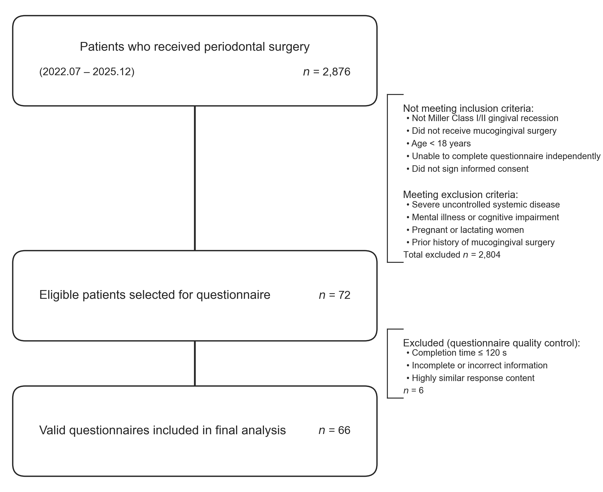

# OBJECTIVE
完成SCI论文写作与制图任务，在markdown和python环境中工作。原始数据保存于'gingival_manuscript/results/survey.csv'。

# INSTRUCTION
## 写稿要求：
- 使用markdown，在`manuscript.md`中撰写
- 请使用中文、英文撰写。主体表达是中文，但是专业术语和固定表达用词使用英文。
- 保持表达的plain。面向临床医生和交叉学科研究者，需要降低阅读门槛，避免使用过于专业的术语。
- 保持表达的concise。提高信息密度，避免无用的单词和句子，保证每一个单词都为论文的核心内容服务。
- 拒绝使用第一人称，保持客观和中立的语气。
- 拒绝加粗、斜体、下划线等强调手段，表达的强调应该通过内容本身的逻辑和结构来实现，而非通过格式上的变化。
- 文章结构清晰，层次分明，逻辑严密。

### 方法（methods）部分的撰写要求：
- 在methods仅作可复现性说明，不讲代码或者技术细节，但是也不能忽略必要细节。

### 结果（results）部分的撰写要求：
- 仅描述结果，禁止不进行的解释和讨论。结果部分应该客观地呈现数据和发现，但是可以通过合理的结构和逻辑来引导读者的注意集中在主要发现和主线逻辑上。
- 结果图表的标题：精简的一句话概括该图表的主题/目的/核心内容，拒绝冗长的标题和副标题。图表标题应该直接、清晰地传达图表的核心内容和意义，避免使用过于复杂或者模糊的语言；
- 结果图表的注释：自释性，提供必要的细节和说明，读者可以脱离正文独立理解图表内容。注释应该清晰、简洁，拒绝过于冗长或者复，拒绝重复描述图标内容/结果内容。

## 画图要求：
- 论文图应要素齐全，构图饱满，元素不相互遮挡，表达清晰，专业美观，符合科学论文的规范和审美要求。
- 使用python,画图脚本储存在对应的结果文件目录下（非结构打包文件夹下、非仓库根目录下），命名为 `Figure_1.py`等。脚本开头保留参数设置部分，并且直接运行脚本能够生成对应的图像文件，不需要额外传入参数，方便后续修改和复用。不同结果如果使用同一种图形或者绘图方法，建议使用同一套参数设置，保持图像风格的一致性。
- 代码写得简约直接，拒绝冗余回退设计，保持代码的简洁和可读性。
- 格式为png，savefig 时设置 dpi=300（80mm 对应 ≥945 px，180mm 对应 ≤2126 px）
- 文件大小 < 10 MB each，宽度控制在 80–180 mm
- 不在图中加入标题和图注。这是markdown的工作，图片只提供图像内容。
- 文字为英文，Arial，larger fonts make for easier reading
- margin: 移除无用白边
- 线宽至少 0.1 mm / 0.3 pt
- 文件名应只用 Figure + 编号，例如 `Figure_1.png`；一图（包括组图）一文件，统一输出在 `./figures` 目录下（不和脚本放在一起）
- 配色方案：主题色：#F3CCDB #E5E5F3 #A8D1E1 #62A9C8 #147EBC；黑色(字体，线条等，不要使用纯黑)"#252525"；背景使用纯白色"#ffffff"。其他颜色也可以使用，但请保持整体风格的一致性和专业性，避免过于鲜艳或不协调的颜色组合。
- 当写完代码，运行生成图像文件后，一定要检查生成的图像文件，确保图像表达清晰、无误，并且符合论文的整体风格和专业性，然后才结束任务。否则需要继续修改代码，直到图像质量和格式符合要求为止。生成图片后必须检查，未通过检查不得结束任务：
    - 字体是否完整显示
    - 坐标轴是否被截断
    - 图例是否遮挡数据

## 图片，表格插入：
使用下面的格式分别将图片和表格插入到`manuscript.md`的对应位置中，注意分别顺序编码

### 图片插入的格式为：
```


图1：【图题】。【图注】
```

### 表格插入的格式为：
```
表1：【表题】

【表格本体】

注：【表注】
```

---

或者帮其他忙，待定。