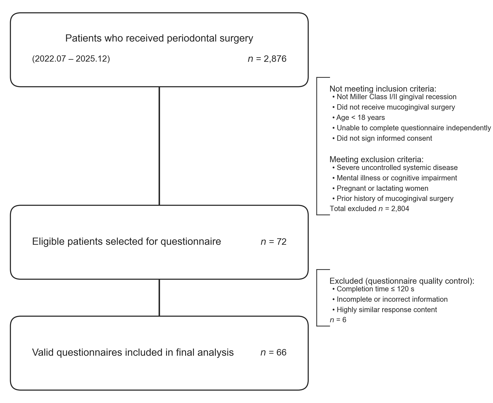
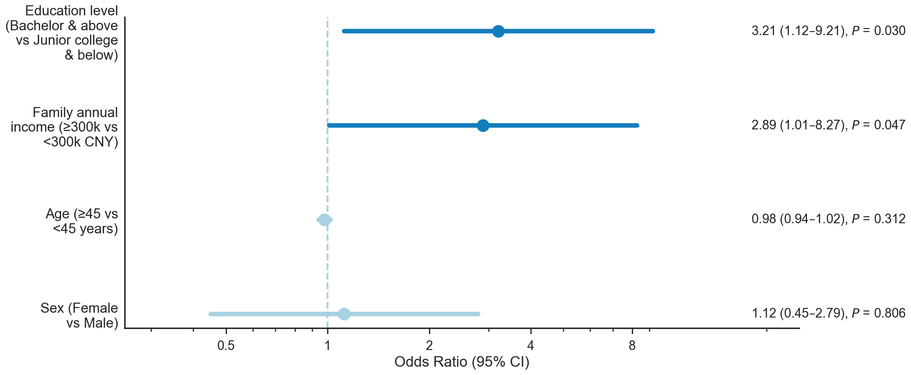
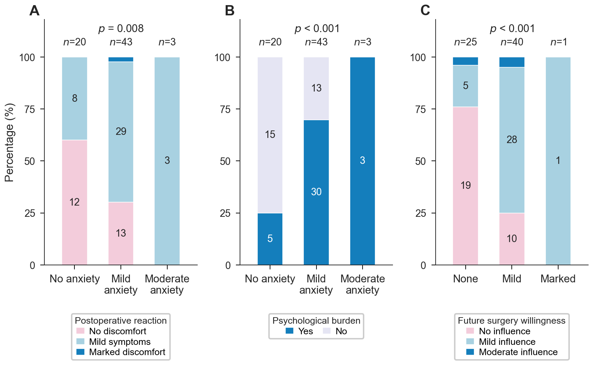

Awareness of Periodontal Mucogingival Surgery and Associated Factors

**Abstract**

Objectives: To evaluate patients' awareness of periodontal mucogingival surgery for gingival recession and identify associated factors, thereby informing preoperative health education by medical students and junior clinicians.

Methods: From 2,876 periodontal surgery patients (July 2022–December 2025), 72 undergoing mucogingival surgery for Miller Class I/II gingival recession were identified; 66 valid questionnaires were analyzed. Associations between demographic and socioeconomic factors and awareness were examined.

Results: Overall, 93.94% of patients actively sought surgery-related information before treatment, with professional medical staff as the primary source (43.94%). Mild preoperative anxiety was reported by 65.15% of patients. Undergraduate education or above and higher household income were independent positive factors associated with awareness. Psychological burden and systemic health status were important factors in surgical decision-making. Age, sex, regular dental checkups, and first-time surgical treatment were not significantly associated with awareness. Preoperative anxiety was positively associated with postoperative reactions and the influence of psychological burden on decision-making, and postoperative reactions were associated with willingness to undergo future surgery.

Conclusions: Patients with gingival recession generally actively sought information about mucogingival surgery, though preoperative anxiety and psychological burden were common. Higher education and income were associated with better awareness, and psychological and systemic factors influenced treatment decisions. Preoperative anxiety was associated with postoperative reactions and willingness to undergo future surgery. Incorporating preoperative psychological assessment and individualized expectation guidance into routine mucogingival surgical care may help interrupt the cycle of anxiety, negative experiences, and surgical avoidance, thereby improving surgical acceptance and treatment outcomes.

**Keywords**: Gingival Recession; Health Knowledge, Attitudes, Practice; Surveys and Questionnaires; Health Education, Dental; Health-Seeking Behavior

**Introduction**

Gingival recession (GR) refers to the apical displacement of the gingival margin from the cementoenamel junction, exposing the root surface. It is one of the most common mucogingival conditions in clinical dentistry. GR may lead to dentin hypersensitivity, root caries, non-carious cervical lesions, difficulty in plaque control, and esthetic concerns in the anterior region, thereby affecting oral health and quality of life (1–3). A recent systematic review and meta-analysis including 22 observational studies reported that the global prevalence of GR was 81.1% (95% CI: 73.9–86.7) using a threshold of ≥1 mm, and 48.4% and 16.2% using thresholds of ≥3 mm and ≥5 mm, respectively (4). With improved living standards and rising aesthetic demands, more patients are seeking dental care for GR. Managing esthetic and functional problems related to GR has therefore become a common clinical need in periodontology.

Mucogingival surgery is a major treatment approach for GR, and root coverage procedures are key techniques for managing this condition (5). Although mucogingival surgical techniques have become increasingly mature, patient awareness of these procedures remains insufficient. A cross-sectional study of 205 participants showed that among 147 patients clinically diagnosed with GR, 38.8% were unaware of their condition, and insufficient awareness was associated with sex, education level, and oral hygiene habits (6). At present, systematic surveys of patient awareness among those undergoing periodontal mucogingival surgery are limited. Patient understanding of the necessity of surgery, procedures, risks, costs, and expected outcomes directly affects treatment decisions and surgical acceptance (7, 8). In addition, the relationships among preoperative anxiety, postoperative reactions, psychological burden, and willingness to undergo future surgery require further investigation.

Therefore, this study conducted a postoperative questionnaire survey among patients with GR who underwent periodontal mucogingival surgery. The study aimed to evaluate current awareness of periodontal mucogingival surgery, analyze associated factors, and further examine the relationships among preoperative anxiety, postoperative reactions, psychological burden, and willingness to undergo future surgery. The findings may provide evidence to optimize preoperative doctor-patient communication, improve surgical acceptance, and enhance treatment outcomes. They may also inform preoperative health education delivered by medical students and junior clinicians.

**Methods**

**Study design and data collection**

This study was approved by the institutional ethics committee (approval number blinded for peer review). A total of 2,876 patients who received periodontal surgery at the study hospital from July 2022 to December 2025 were screened. Among them, 72 patients underwent periodontal mucogingival surgery for Miller Class I or II GR. A retrospective questionnaire survey was conducted using the hospital's electronic medical record system and postoperative follow-up registry.

The inclusion criteria were as follows: (1) clinical diagnosis of Miller Class I or II GR; (2) receipt of periodontal mucogingival surgery; (3) age ≥18 years; (4) ability to complete the questionnaire independently; and (5) voluntary signing of informed consent.

The exclusion criteria were as follows: (1) severe systemic disease, including uncontrolled hypertension, diabetes, or severe cardiovascular or cerebrovascular disease; (2) psychiatric disease or cognitive impairment; (3) pregnancy or lactation; and (4) a previous history of periodontal mucogingival surgery.

A senior nurse and medical students in the research team served as investigators. Before the formal survey, all investigators received standardized training on the study's purpose and participant eligibility criteria. The electronic questionnaire was distributed through WeChat. Each IP address or WeChat account was allowed to submit the questionnaire only once, and all items had to be completed before submission to avoid missing data. Questionnaires were considered invalid if the completion time was ≤120 s, information was incomplete or incorrect, or responses were highly repetitive. A total of 72 questionnaires were distributed, and 66 valid questionnaires were collected, yielding an effective response rate of 91.7%. During data collection and analysis, questionnaire data were independently checked by two researchers before statistical analysis. The sample selection process is shown in Figure 1.

> Figure 1. Flowchart of sample selection. Among 2,876 patients who received periodontal surgery, 72 eligible patients were identified according to the inclusion and exclusion criteria and invited to complete the questionnaire. Six invalid questionnaires were excluded after quality control, and 66 valid questionnaires were included in the final analysis.

**Questionnaire**

The questionnaire was developed with reference to the WHO oral health report, the Fourth National Oral Health Survey of China, and relevant domestic and international literature (9–12). After the initial questionnaire was drafted, six medical experts from dentistry and nursing were invited to evaluate content validity. The scale-level content validity index (S-CVI) was 0.98. A pilot survey was then conducted among 10 conveniently selected patients to assess whether each item was easy to understand and to reduce ambiguity. Cronbach's alpha was 0.813, indicating good reliability (13).

The questionnaire included three sections: (1) basic patient information, including sex, age, education level, marital status, income level, medical insurance type, and history of dental visits; (2) awareness of periodontal mucogingival surgery, including preoperative information sources, surgical procedures, preoperative anxiety, doctor-patient communication, informed consent, awareness of initial periodontal therapy, and postoperative reactions; and (3) factors affecting surgical acceptance, including the influence of awareness, cost, psychological burden, systemic health status, and subsequent treatment options on decision-making. The questionnaire contained 20 single-choice items. The English version of the questionnaire is provided in Supporting Information S1.

**Statistical analysis**

SPSS 25.0 was used for statistical analysis. Categorical data were expressed as frequencies and percentages, *n* (%). Whether patients actively sought professional explanations about surgery-related knowledge before surgery was used as the indicator of awareness. Univariate analyses were performed for sex, age, education level, marital status, annual household income, medical insurance type, time since first dental treatment, regular dental checkups, and first-time surgical treatment. Categorical variables were compared using Fisher's exact tests. Variables with statistical significance in univariable analysis and clinically relevant variables were included in the logistic regression model, with active preoperative seeking of professional explanations about surgery-related knowledge as the dependent variable. Odds ratios (ORs) and 95% confidence intervals (CIs) were calculated. Fisher-Freeman-Halton exact tests were also used to examine associations among preoperative anxiety, postoperative reactions, psychological burden, and willingness to undergo future surgery. A P value <0.05 was considered statistically significant.

**Results**

**Patient awareness of periodontal mucogingival surgery**

A total of 66 patients were included. Among them, 93.94% actively sought surgery-related information before treatment, and professional medical staff were the most common source of information (43.94%). Mild preoperative anxiety was reported by 65.15% of patients. Additional results are shown in Table 1.

**Univariable analysis of factors associated with awareness**

Among the included patients, women (65.15%), patients aged 18–44 years (60.60%), patients with undergraduate education or above (75.76%), patients who had regular dental checkups (75.76%), and patients receiving periodontal surgery for the first time (69.70%) accounted for relatively high proportions. Fisher's exact tests showed that education level and annual household income were significantly associated with awareness (*P* < 0.05). Age, sex, marital status, medical insurance type, time since first dental treatment, regular dental checkups, and first-time surgical treatment were not significantly associated with awareness (*P* > 0.05). Detailed results are shown in Table 2.

**Multivariable logistic regression analysis of factors associated with awareness**

Logistic regression showed that education level and annual household income were independent positive factors associated with awareness of periodontal mucogingival surgery (OR > 1, *P* < 0.05). Patients with higher education and higher income had better awareness. Age and sex did not significantly affect awareness (*P* > 0.05). Details are shown in Figure 2.

> Figure 2. Logistic regression forest plot of factors associated with awareness of periodontal mucogingival surgery. Blue solid dots indicate *P* < 0.05, and light blue dots indicate *P* ≥ 0.05. Horizontal lines indicate 95% confidence intervals, and the vertical dashed line indicates OR = 1.

**Associations among preoperative anxiety, postoperative reactions, psychological burden, and surgical willingness**

Preoperative anxiety level was positively associated with postoperative reactions (*P* = 0.008). In the no-anxiety group, 60.0% of patients reported no specific postoperative discomfort. In the mild-anxiety group, 67.4% reported mild symptoms. All patients in the moderate-anxiety group reported mild symptoms. Preoperative anxiety was also positively associated with the influence of psychological burden on decision-making (*P* = 0.001). Only 25.0% of patients in the no-anxiety group reported that psychological burden affected their surgical choice. In contrast, this proportion increased to 69.8% in the mild-anxiety group and 100.0% in the moderate-anxiety group. The association between postoperative reactions and willingness to undergo future surgery was the most significant (*P* < 0.001). In the group without postoperative discomfort, 76.0% reported that the experience would not affect future surgical decisions. In the mild-symptom group, 70.0% reported a mild influence. The patient with obvious discomfort (*n* = 1) reported a mild influence. Details are shown in Figure 3.

> Figure 3. Associations among preoperative anxiety, postoperative reactions, psychological burden, and willingness to undergo future surgery. A: Distribution of preoperative anxiety levels and postoperative reactions. B: Distribution of preoperative anxiety levels and the influence of psychological burden on surgical choice. C: Distribution of postoperative reactions and willingness to undergo future surgery. Stacked bar charts show percentages; numbers inside bars indicate actual counts, and numbers above bars indicate the total sample size of each group. *P* values were obtained from Fisher-Freeman-Halton tests for corresponding categorical variables.

**Discussion**

This questionnaire survey included 66 patients with GR who underwent mucogingival surgery and systematically evaluated their awareness and behavioral status. Education level and annual household income were identified as independent positive factors associated with awareness, and associations among preoperative anxiety, postoperative reactions, and willingness to undergo future surgery were observed. These findings have not been previously reported in retrospective studies of mucogingival surgery among patients with GR.

Among the 66 respondents, 93.94% actively sought surgery-related information, but only 43.94% obtained information through professional medical channels. More than half relied on online platforms, relatives, or no information sources at all. The prevalence of preoperative anxiety was 69.70%, mainly mild anxiety. In terms of objective awareness, the overall level was favorable: 96.97% of patients partly or fully understood the mucogingival surgical procedure, and 98.48% knew the necessity of initial periodontal therapy before surgery. This may be related to targeted preoperative oral health education (14, 15). However, 12.12% of patients still did not clearly understand the content of doctor-patient communication (Table 1), suggesting that current preoperative health education may lack individualized design. Jönsson et al. found that individually tailored oral health education had greater clinical value than standardized education (16), supporting the need to optimize preoperative communication.

After clarifying the current awareness status, key factors associated with awareness were further analyzed. Univariable analysis (Table 2) and multivariable analysis (Figure 2) consistently showed that education level (undergraduate or above, OR = 3.21, *P* = 0.030) and annual household income (≥300,000 Chinese yuan, OR = 2.89, *P* = 0.047) were independent positive factors associated with awareness. Education level is considered one of the most important determinants of health literacy, and health literacy mediates the relationship between socioeconomic status and health status, health behaviors, and preventive awareness (17). Patients with higher education may have stronger abilities to obtain and understand information. In contrast, patients with higher income may be more motivated to seek professional information through active health care use and online searching. This is consistent with a recent finding that, within the knowledge-attitude-practice framework, access to knowledge sources determines awareness level (18). By contrast, age, sex, regular checkups, and first-time surgery were not significantly associated with awareness (Table 2), indicating limited explanatory value of these demographic variables and suggesting that clinical interventions should pay greater attention to socioeconomic factors (19).

In addition to socioeconomic factors, psychological and systemic factors should not be overlooked in surgical decision-making. In this survey, 57.58% of patients reported that psychological burden affected their surgical choice (Figure 3B), and 71.21% were concerned about the influence of systemic health status on surgery. Wright et al. reported that patient behavioral factors, including anxiety and personality traits, can significantly affect dental implant treatment outcomes (20), which is consistent with the finding that psychological burden affected surgical choice in this study. Dental anxiety and dental phobia often begin in childhood. They may persist into adulthood, leading to treatment-related psychological burden, avoidance of dental care, and subsequent deterioration in oral health and quality of life (21–23). Cognitive behavioral therapy has been shown to effectively reduce anxiety and psychological burden before dental treatment (24, 25). In addition, although mucogingival surgery is a local treatment, systemic factors such as blood pressure and blood glucose may directly affect surgical safety and prognosis (26). The patient's concern about systemic health status, therefore, reflects a reasonable concern about treatment safety. Incorporating preoperative psychological assessment, counseling, and systemic condition evaluation into routine mucogingival surgical care is clinically justified.

These psychological factors were not isolated. The association analysis further showed relationships among preoperative anxiety, postoperative reactions, psychological burden, and willingness to undergo future surgery. Patients with higher preoperative anxiety tended to report more obvious postoperative discomfort (Figure 3A, *P* = 0.008). Prospective studies in other fields of oral surgery have supported this pattern. A hospital-based prospective cohort study of 213 patients undergoing mandibular third molar extraction showed a significant positive association between preoperative dental anxiety and postoperative symptom severity; patients with anxiety had higher composite scores for postoperative pain, swelling, and related symptoms (27). Anxiety level was also associated with psychological burden related to future surgery (Figure 3B, *P* = 0.001). Only a minority of patients without anxiety reported that psychological burden affected surgical choice, whereas all patients with moderate anxiety reported such an influence. Classic research on dental anxiety describes this process as a vicious cycle: anxiety triggers avoidance of treatment, negative dental experiences reinforce anxious expectations, and psychological resistance to subsequent interventions increases, leaving patients with a heavier psychological burden when facing another surgical decision (20). The association between postoperative reactions and willingness to undergo future surgery was the strongest (Figure 3C, *P* < 0.001). Most patients without obvious postoperative discomfort reported that the experience would not affect future surgical decisions, whereas patients with symptoms tended to consider repeat surgery more cautiously. This trend is highly consistent with studies on preoperative expectation management. A randomized controlled trial of 172 patients undergoing total knee arthroplasty showed that patients receiving structured preoperative education on realistic expectations had significantly higher postoperative satisfaction and a greater willingness to undergo repeat surgery than controls, suggesting that realistic expectation guidance can reduce negative experiences caused by unmet expectations (28). Although postoperative reactions in this survey were generally mild, the findings have clinical implications for mucogingival surgery. Active management of postoperative discomfort and individualized preoperative expectation guidance may help interrupt the cycle of anxiety, negative experiences, and surgical avoidance, reduce psychological concerns about repeat surgery, and improve long-term adherence and treatment outcomes. These three analyses did not adjust for other covariates, and causal relationships should be verified in larger longitudinal studies.

This study has several limitations. The sample size was relatively small (66 patients) compared with the number of variables in the logistic regression model, and the estimated events per variable were insufficient; therefore, the regression results' robustness needs to be validated in larger samples. The questionnaire was self-developed and revised following pilot testing, but its scientific validity remains to be confirmed. The cross-sectional design could not determine causal relationships between awareness and clinical outcomes. Future multicenter prospective studies with larger samples are needed to explore the effects of preoperative awareness interventions on surgical acceptance and postoperative satisfaction.

Patients with GR showed a generally positive attitude toward actively seeking information about mucogingival surgery, but preoperative anxiety and psychological burden were common. Education level and annual household income were key factors associated with awareness, underscoring the need for stratified, refined oral health promotion strategies and individualized oral health education for populations with varying levels of education and income. In addition, preoperative anxiety was associated with postoperative reactions and willingness to undergo future surgery. Active postoperative management and reasonable preoperative expectation guidance may help interrupt the cycle of anxiety, negative experiences, and surgical avoidance. Preoperative psychological assessment and counseling should become routine components of mucogingival surgical care. These findings may provide evidence for preoperative health education by medical students and junior clinicians and may help improve surgical acceptance and treatment outcomes among patients with GR.

**REFERENCES**

1. Reis MBL, Mandetta CMR, Dantas CDF, Marañón-Vásquez G, Taba M Jr, de Souza SLS, et al. Root coverage of gingival recessions with non-carious cervical lesions: A controlled clinical trial. Clin Oral Investig. 2020;24(12):4583-4589. doi:10.1007/s00784-020-03325-1

2. Santamaria MP, Miguel MMV, Rossato A, Bonafé ACF, de Souza IV, Martins TM, et al. Volume-stable collagen matrix to treat gingival recession associated with non-carious cervical lesions: Randomized clinical trial. J Periodontol. 2026;97(1):62-73. doi:10.1002/jper.11386

3. Cortellini P, Bissada NF. Mucogingival conditions in the natural dentition: Narrative review, case definitions, and diagnostic considerations. J Periodontol. 2018;89(Suppl 1):S204-S213. doi:10.1002/JPER.16-0671

4. Marschner F, Lechte C, Kanzow P, Hraský V, Pfister W. Systematic review and meta-analysis on prevalence and risk factors for gingival recession. J Dent. 2025;155:105645. doi:10.1016/j.jdent.2025.105645

5. Zucchelli G, Mounssif I. Periodontal plastic surgery. Periodontol 2000. 2015;68(1):333-368. doi:10.1111/prd.12059

6. Yılmaz M, Oduncuoğlu BF, Nişancı Yılmaz MN. Evaluation of patients' perception of gingival recession, its impact on oral health-related quality of life, and acceptance of treatment plan. Acta Odontol Scand. 2020;78(6):454-462. doi:10.1080/00016357.2020.1758773

7. Miller TA. Health literacy and adherence to medical treatment in chronic and acute illness: A meta-analysis. Patient Educ Couns. 2016;99(7):1079-1086. doi:10.1016/j.pec.2016.01.020

8. McCaffery KJ, Holmes-Rovner M, Smith SK, Rovner D, Nutbeam D, Clayman ML, et al. Addressing health literacy in patient decision aids. BMC Med Inform Decis Mak. 2013;13(Suppl 2):S10. doi:10.1186/1472-6947-13-S2-S10

9. An R, Chen W, Li S, Wu Z, Liu M, Sohaib M. Assessment of the oral health literacy and oral health behaviors among nurses in China: A cross-sectional study. BMC Oral Health. 2022;22:602. doi:10.1186/s12903-022-02658-5

10. Deeden S, Vichayanrat T, Asvanund Y, Prapansilp W, Phonghanyudh A. Knowledge, attitudes, and practices towards ECC prevention in Thai medical personnel. Int Dent J. 2024;74:253-259. doi:10.1016/j.identj.2023.08.008

11. Tsui PK, Chau PH, Wong JYH, Wang MP, Gao X, Lam OLT, et al. Oral care knowledge, attitude and practice among nursing staff in acute hospital settings in Hong Kong. PLoS One. 2023;18:e0289953. doi:10.1371/journal.pone.0289953

12. Tan L, Lin Z, Zhang Y, Sun N, Ding Q, Feng H, et al. Information-knowledge-attitude-practice model in non-suicidal self-injury behaviours of adolescence and young adults with major depressive disorder: Randomised controlled trials. J Psychiatr Ment Health Nurs. 2025;32:766-773. doi:10.1111/jpm.13154

13. Jalali A, Naghibzadeh A, Mohammadi MM, Rostami M, Kalhory P, Taghvostani NM, et al. Translation and validation of the Persian version of the Nursing Practice Readiness Scale (NPRS) for new graduate nurses. BMC Nurs. 2024;23:606. doi:10.1186/s12912-024-02434-6

14. Wittink H, Oosterhaven J. Patient education and health literacy. Musculoskelet Sci Pract. 2018;38:120-127. doi:10.1016/j.msksp.2018.06.004

15. Margat A, Gagnayre R, Lombrail P, de Andrade V, Azogui-Levy S. Interventions en littératie en santé et éducation thérapeutique : une revue de la littérature [Health literacy and patient education interventions: A review]. Sante Publique. 2017;29(6):811-820. doi:10.3917/spub.176.0811

16. Jönsson B, Ohrn K, Lindberg P, Oscarson N. Evaluation of an individually tailored oral health educational programme on periodontal health. J Clin Periodontol. 2010;37(10):912-919. doi:10.1111/j.1600-051X.2010.01590.x

17. Stormacq C, Van den Broucke S, Wosinski J. Does health literacy mediate the relationship between socioeconomic status and health disparities? Integrative review. Health Promot Int. 2019;34(5):e1-e17. doi:10.1093/heapro/day062

18. Xiao F, Yu D, Huang Y, Zhang T, He H, Luo W, et al. Oral health knowledge, attitudes, and practices and associated factors among non-dental healthcare professionals in South China: A cross-sectional study. Front Public Health. 2026;14:1811364. doi:10.3389/fpubh.2026.1811364

19. Amer MS, Mossa SM, Abdul-Rahman SA, Mabrook RA, Raafat VA. Relationship between socioeconomic factors and cognitive function in elderly caregivers. J Am Geriatr Soc. 2015;63(4):818-820. doi:10.1111/jgs.13373

20. Wright KE, Luz DS, Dragan IF. Applying patient behavioral assessment to enhance dental implant treatment outcomes. Compend Contin Educ Dent. 2025;46(7):336-342.

21. Seligman LD, Hovey JD, Chacon K, Ollendick TH. Dental anxiety: An understudied problem in youth. Clin Psychol Rev. 2017;55:25-40. doi:10.1016/j.cpr.2017.04.004

22. Kassem El Hajj H, Fares Y, Abou-Abbas L. Assessment of dental anxiety and dental phobia among adults in Lebanon. BMC Oral Health. 2021;21(1):48. doi:10.1186/s12903-021-01409-2

23. Tellez M, Potter CM, Kinner DG, Jensen D, Waldron E, Heimberg RG, et al. Computerized tool to manage dental anxiety: A randomized clinical trial. J Dent Res. 2015;94(9 Suppl):174S-180S. doi:10.1177/0022034515598134

24. Armfield JM, Heaton LJ. Management of fear and anxiety in the dental clinic: A review. Aust Dent J. 2013;58(4):390-407. doi:10.1111/adj.12118

25. Gordon D, Heimberg RG, Tellez M, Ismail AI. A critical review of approaches to the treatment of dental anxiety in adults. J Anxiety Disord. 2013;27(4):365-378. doi:10.1016/j.janxdis.2013.04.002

26. Parameter on periodontitis associated with systemic conditions. J Periodontol. 2000;71(Suppl 5S):876-879. doi:10.1902/jop.2000.71.5-S.876

27. Qiao F, Zhang M, Zhang T, Zhu D. Dental anxiety is related to postoperative symptoms in third molar surgery. Front Psychiatry. 2022;13:956566. doi:10.3389/fpsyt.2022.956566

28. Nam HS, Yoo HJ, Ho JPY, Kim YB, Lee YS. Preoperative education on realistic expectations improves the satisfaction of patients with central sensitization after total knee arthroplasty: A randomized-controlled trial. Knee Surg Sports Traumatol Arthrosc. 2023;31(11):4705-4715. doi:10.1007/s00167-023-07487-9

Table 1. Patient awareness of periodontal mucogingival surgery

| Item | Category | *n* (%) |
| --- | --- | --- |
| Source of preoperative surgery-related information | Attending doctor or nurse | 29 (43.94) |
|  | Online platforms | 22 (33.33) |
|  | Relatives | 11 (16.67) |
|  | No information sought | 4 (6.06) |
| Understanding of the mucogingival surgical procedure | Fully understood | 25 (37.88) |
|  | Partly understood | 39 (59.09) |
|  | Did not understand | 2 (3.03) |
| Awareness of the necessity of initial periodontal therapy before surgery | Yes | 65 (98.48) |
|  | No | 1 (1.52) |
| Preoperative anxiety level | No anxiety | 20 (30.30) |
|  | Mild anxiety | 43 (65.15) |
|  | Moderate anxiety | 3 (4.55) |
|  | Severe anxiety | 0 (0.00) |
| Preoperative communication | Informed and fully understood | 58 (87.88) |
|  | Informed but not fully understood | 8 (12.12) |

> Note: *N* = 66. Data are presented as *n* (%). Preoperative anxiety was self-reported by patients using the four-level categories preset in the questionnaire: no anxiety, mild anxiety, moderate anxiety, and severe anxiety.

Table 2. Basic patient characteristics and univariable analysis of factors associated with awareness

| Variable | Category | Total, *n* (%) | Actively sought professional explanations, *n* (%) | Did not actively seek professional explanations, *n* (%) | *P* |
| --- | --- | --- | --- | --- | --- |
| Sex | Female | 43 (65.15) | 19 (44.19) | 24 (55.81) | 0.956 |
| Age | <45 years | 40 (60.61) | 18 (45.00) | 22 (55.00) | 0.831 |
| Education level | Undergraduate or above | 50 (75.76) | 26 (52.00) | 24 (48.00) | 0.022 |
| Marital status | Married | 48 (72.73) | 22 (45.83) | 26 (54.17) | 0.653 |
| Annual household income | <300,000 CNY | 36 (54.55) | 12 (33.33) | 24 (66.67) | 0.045 |
|  | ≥300,000 CNY | 15 (22.73) | 9 (60.00) | 6 (40.00) |  |
|  | Preferred not to answer | 15 (22.73) | 8 (53.33) | 7 (46.67) |  |
| Medical insurance type | Employee medical insurance | 33 (50.00) | 15 (45.45) | 18 (54.55) | 0.768 |
| Time since first dental treatment | <5 years | 47 (71.21) | 21 (44.68) | 26 (55.32) | 0.856 |
| Regular dental checkups | Yes | 50 (75.76) | 23 (46.00) | 27 (54.00) | 0.593 |
| First-time surgical treatment | Yes | 46 (69.70) | 19 (41.30) | 27 (58.70) | 0.574 |

> Note: *N* = 66. Data are presented as *n* (%). *P* values were obtained from Fisher's exact tests for corresponding categorical variables. "Actively sought professional explanations" was defined as obtaining surgery-related information from the attending doctor or nurse before surgery and was used as the proxy indicator of awareness. *P* < 0.05 was considered statistically significant. "Preferred not to answer" was not included in the Fisher's exact calculation. CNY, Chinese yuan.