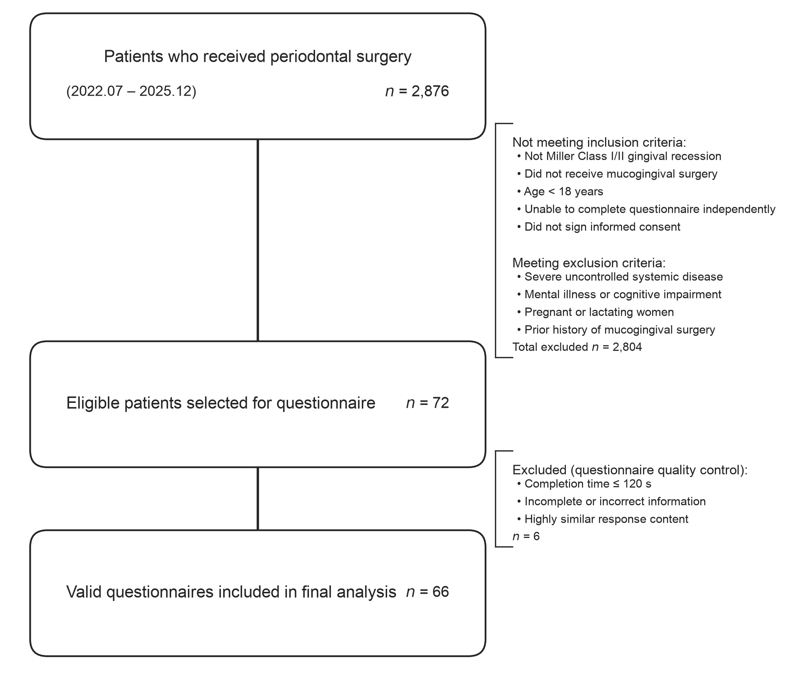
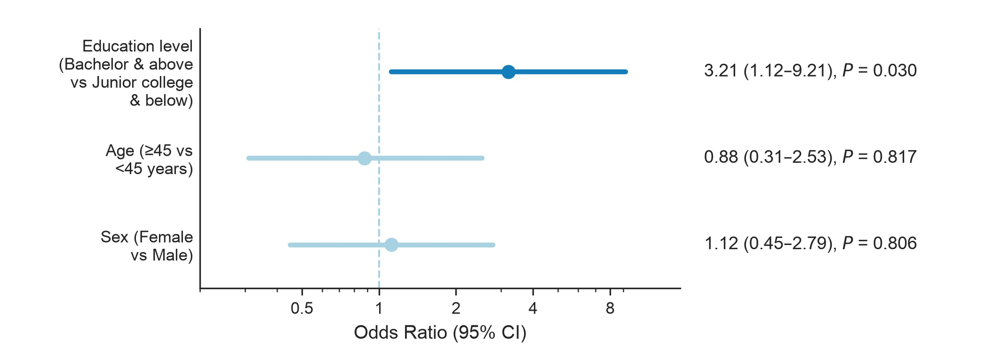
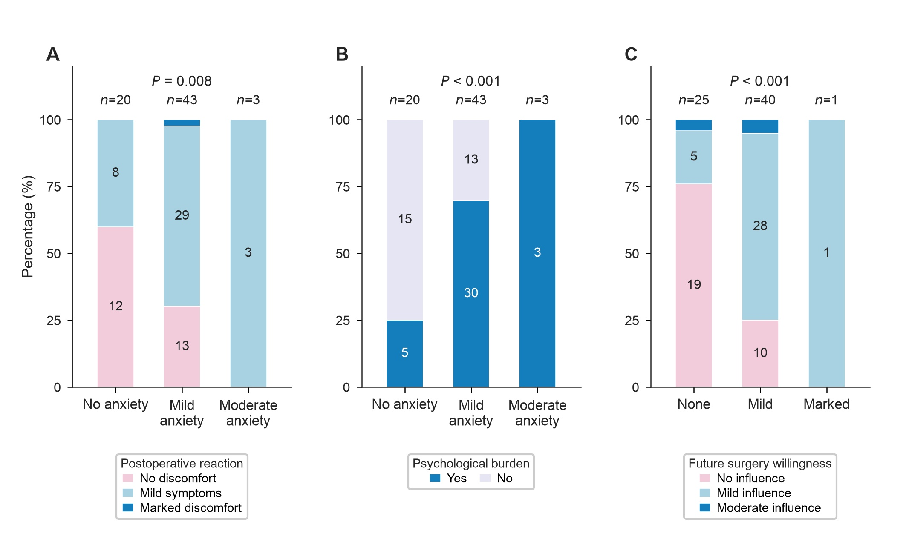

罗伟^1,\ #^，潘润朗^1,\ #^，刘淑婷^1^，周满盈^1^，张婷^1^，黄映思^1,\ \*^，覃文广^1,\ \*^

^1^ 广州医科大学附属口腔医院牙周病科，广东省口腔修复与重建工程技术研究中心，广州，510182，中国

^#^ 这些作者对本工作贡献相同，同为第一作者。

^\*^ 通讯作者：  
覃文广：2015686011@gzhmu.edu.cn  
黄映思：467965641@qq.com  

正文字数：约 4,800 字（不含摘要、参考文献、表格和图注）  
摘要字数：约 650 字  
图片数量：3  
表格数量：2  

# 摘要

目的：明确牙龈退缩患者对牙周膜龈手术的术前信息寻求行为及对手术特定流程的认知理解，分析通过专业医疗渠道获取手术信息的相关影响因素，为医学生及低年资临床医师开展术前健康教育提供参考。

方法：在这项于中国某三甲口腔专科医院开展的单中心横断面问卷调查中，回顾性筛选了2022年7月至2025年12月期间接受牙周手术治疗的2,876例患者病历资料。在因Cairo RT1类牙龈退缩接受牙周膜龈手术的72例患者中，回收有效问卷66份并纳入分析。分析了人口学与社会经济因素与专业医疗信息寻求之间的关联。

结果：总体上，93.94%的患者在术前主动寻求手术相关信息，其中专业医护人员为首要获取途径（43.94%）。患者对手术特定流程的理解整体良好（96.97%理解手术流程；98.48%知晓术前需行牙周基础治疗）。65.15%的患者报告存在轻度术前焦虑。本科及以上学历是患者寻求专业医疗信息的独立正向影响因素（OR = 3.21，95% CI：1.12–9.21，P = 0.030）。心理负担与全身健康状况是影响手术决策的重要因素。年龄、性别、家庭年均收入、是否定期进行牙科检查及是否首次接受牙周手术与该结局指标无显著关联。术前焦虑程度与术后反应以及心理负担对决策的影响呈正相关，且术后反应与未来手术意愿显著相关。

结论：受教育程度与专业信息寻求独立相关，而围手术期焦虑和术后体验显著影响患者的手术决策。将术前心理评估与个体化预期引导纳入膜龈手术常规临床诊疗路径，可能有助于阻断“焦虑-负面体验-手术回避”的循环，从而提高手术接受度并改善治疗结局。

关键词：牙龈退缩；健康知识、态度、实践；调查与问卷；口腔健康教育；信息寻求行为

# 引言

牙龈退缩（gingival recession, GR）是指龈缘向釉牙骨质界根方移位所致的牙根表面暴露，是口腔临床最常见的膜龈病变之一。牙龈退缩可导致牙本质敏感、根面龋、非龋性牙颈部缺损、菌斑控制困难及前牙美学缺陷，进而影响患者的口腔健康与生活质量（1–3）。近期一项纳入22项观察性研究的系统评价与Meta分析显示，在≥1 mm的诊断阈值下，全球人群牙龈退缩患病率为81.1%（95% CI：73.9–86.7），在≥3 mm和≥5 mm的阈值下分别为48.4%和16.2%（4）。随着生活水平的提高和美学需求的增长，因牙龈退缩就医的患者日益增多。因此，解决与牙龈退缩相关的审美及功能问题已成为牙周病学领域的常见临床需求。

膜龈手术是治疗牙龈退缩的主要手段，其中根面覆盖术是处理该病变的关键技术（5）。尽管膜龈手术技术已日趋成熟，但关于接受此类手术的患者如何获取术前信息以及如何理解手术相关细节的证据仍十分有限。一项纳入205名受检者的横断面研究显示，在临床确诊为牙龈退缩的147例患者中，38.8%并未意识到自身存在退缩病变，且疾病认知缺乏与性别、受教育程度及口腔卫生习惯显著相关（6）。然而，针对接受牙周膜龈手术患者的术前信息寻求模式及手术特定流程认知理解的系统性调查仍较为匮乏。患者对手术必要性、手术流程、潜在风险、费用及预期效果的理解，直接影响其治疗决策与手术接受度（7, 8）。此外，术前焦虑、术后反应、心理负担与未来手术意愿之间的内在关联，仍有待进一步深入探讨。

为此，本研究在接受牙周膜龈手术的牙龈退缩患者中开展了一项回顾性问卷调查。研究旨在明确患者对牙周膜龈手术的术前信息寻求行为与手术特定流程认知理解，分析通过专业医疗渠道获取信息的相关影响因素，并探讨术前焦虑、术后反应、心理负担与未来手术意愿之间的关联。本研究结果可为优化术前医患沟通、提高手术接受度及改善治疗结局提供循证依据，同时也可为医学生及低年资临床医师开展术前健康教育提供参考。

# 方法

## 研究设计与数据收集

本研究获得广州医科大学附属口腔医院伦理委员会审查批准（伦理审批号：LCYJ2023055）。批准的研究方案涵盖对2022年7月及以后接受手术患者的【回顾性筛选】。本研究共筛选了2022年7月至2025年12月期间在广州医科大学附属口腔医院接受牙周手术治疗的2,876例患者病历资料。其中，72例患者因Cairo RT1类牙龈退缩接受了牙周膜龈手术。依托医院电子病历系统及术后随访登记表开展了回顾性问卷调查。本研究遵循观察性流行病学研究报告规范（STROBE）横断面研究报告指南（9）以及网络电子调查结果报告核查表（CHERRIES）（10）进行报告。完整的核查表见补充材料S2和S3。

纳入标准如下：（1）临床诊断为Cairo RT1类牙龈退缩；（2）接受了牙周膜龈手术治疗；（3）年龄≥18岁；（4）能够独立完成问卷填写；（5）提供参与本问卷调查的电子知情同意。

排除标准如下：（1）合并严重全身系统性疾病，包括未受控制的高血压、糖尿病或严重心脑血管疾病；（2）精神疾病或认知功能障碍；（3）妊娠期或哺乳期；（4）既往有牙周膜龈手术史（有非膜龈类牙周手术史者允许纳入）。

课题组由一名主管护师与医学生担任调查员。正式调查前，所有调查员均接受了关于研究目的和受试者入组标准的规范化培训。电子问卷通过微信平台进行发放。问卷首页呈现研究介绍及电子知情同意选项，仅有主动提供电子知情同意的患者方可进入问卷作答页面。每个IP地址或微信号仅限提交一次问卷，且提交前所有题目必须作答完毕，以避免数据缺失。问卷作答时间≤120秒、信息填写不完整或错误、或选项高度规律重复者视为无效问卷。共发放问卷72份，回收有效问卷66份，有效回收率为91.7%。在数据收集与分析阶段，问卷数据在统计分析前由两名研究人员进行独立核对。样本筛选流程见图1。

图1：研究样本筛选流程图。在接受牙周手术治疗的2,876例患者中，根据纳入和排除标准筛选出72例符合条件的患者并邀请其完成问卷调查。经问卷质量控制排除6份无效问卷，最终纳入66份有效问卷进行统计分析。

## 调查问卷

调查问卷参考世界卫生组织（WHO）口腔健康报告、第四次全国口腔健康流行病学调查及相关国内外文献进行编制（11–14）。问卷初稿形成后，邀请了口腔医学与护理学专业的6名医学专家进行内容效度评价，量表水平的内容效度指数（S-CVI）为0.98。随后在便利抽样的10例患者中开展了预调查，以评估各条目是否通俗易懂并消除歧义。经检验，问卷的Cronbach's α系数为0.813，表明其具备良好的信度（15）。

问卷共包含三个部分：（1）患者基本信息，包括性别、年龄、受教育程度、婚姻状况、收入水平、医保类型及牙科就诊史；（2）术前信息寻求、手术特定流程认知理解及围手术期体验，包括信息来源途径、手术流程理解、术前焦虑程度、医患沟通情况、知情同意签署、牙周基础治疗认知及术后反应；（3）手术接受度的影响因素，包括对手术的认知理解、手术费用、心理负担、全身健康状况以及对后续治疗方案选择对决策的影响。问卷共包含20个单项选择题条目。问卷英文版见补充材料S1。

## 统计学分析

采用SPSS 25.0软件进行统计分析。分类资料以频数和百分率表示，n（%）。统计建模的主要因变量为术前专业医疗信息寻求，定义为直接向主管医生或护士获取手术相关信息（相对于其他渠道或未了解）。评估手术具体流程认知和牙周基础治疗知晓情况的条目采用描述性统计进行评价。采用Fisher确切概率法对性别、年龄、受教育程度、婚姻状况、家庭年均收入、医保类型、首次牙科治疗年限、是否定期进行牙科检查以及是否首次接受牙周手术进行单因素分析。将单因素分析中具有统计学显著性的变量以及具有临床相关性的变量纳入多因素Logistic回归模型，计算优势比（OR）及其95%置信区间（CI）。同时采用Fisher-Freeman-Halton确切概率检验分析术前焦虑程度、术后反应、心理负担以及未来手术意愿之间的关联。以P < 0.05为差异具有统计学意义。

# 结果

## 术前信息寻求与手术特定认知理解

研究共纳入66例患者。总体而言，93.94%的患者在术前主动寻求了手术相关信息，其中专业医护人员（主管医生或护士）是首要的信息来源途径（43.94%）。患者对手术特定流程的理解整体良好：96.97%的患者部分或完全理解膜龈手术流程，98.48%知晓术前需行牙周基础治疗。65.15%的患者报告存在轻度术前焦虑。其余具体结果见表1。

表1：术前信息寻求、手术特定认知理解及围手术期体验

| 调查项目 | 类别 | n (%) |
| --- | --- | --- |
| 术前手术相关信息获取途径 | 主管医生或护士 | 29 (43.94) |
|  | 网络平台 | 22 (33.33) |
|  | 亲友 | 11 (16.67) |
|  | 未了解 | 4 (6.06) |
| 膜龈手术流程理解程度 | 完全理解 | 25 (37.88) |
|  | 部分理解 | 39 (59.09) |
|  | 不理解 | 2 (3.03) |
| 知晓术前需行牙周基础治疗的必要性 | 是 | 65 (98.48) |
|  | 否 | 1 (1.52) |
| 术前焦虑程度 | 完全无焦虑 | 20 (30.30) |
|  | 轻度焦虑 | 43 (65.15) |
|  | 中度焦虑 | 3 (4.55) |
|  | 重度焦虑 | 0 (0.00) |
| 术前医患沟通情况 | 有告知且完全明白 | 58 (87.88) |
|  | 有告知但不完全明白 | 8 (12.12) |
|  | 完全没有告知 | 0 (0.00) |
| 术后反应 | 无特殊不适 | 25 (37.88) |
|  | 轻微症状 | 40 (60.61) |
|  | 明显不适 | 1 (1.52) |

注：N = 66。数据以 n (%) 表示。术前焦虑程度由患者采用问卷预设的四级分类标准进行自我报告：完全无焦虑、轻度焦虑、中度焦虑和重度焦虑。

## 专业信息寻求相关影响因素的单因素分析

在纳入的患者中，女性（65.15%）、18–44岁患者（60.61%）、本科及以上学历者（75.76%）、定期进行牙科检查者（75.76%）以及首次接受牙周手术者（69.70%）所占比例相对较高。Fisher确切概率法检验显示，受教育程度与专业信息寻求显著相关（P < 0.05）。年龄、性别、婚姻状况、家庭年均收入、医保类型、首次牙科治疗年限、是否定期进行牙科检查以及是否首次接受牙周手术与该结局指标均无显著关联（P > 0.05）。详细结果见表2。

表2：患者基本特征及专业信息寻求影响因素的单因素分析

| 变量 | 类别 | 合计，n (%) | 寻求专业信息，n (%) | 未寻求专业信息，n (%) | P |
| --- | --- | --- | --- | --- | --- |
| 性别 | 女性 | 43 (65.15) | 19 (44.19) | 24 (55.81) | 1.000 |
|  | 男性 | 23 (34.85) | 10 (43.48) | 13 (56.52) |  |
| 年龄 | <45岁 | 40 (60.61) | 18 (45.00) | 22 (55.00) | 1.000 |
|  | ≥45岁 | 26 (39.39) | 11 (42.31) | 15 (57.69) |  |
| 受教育程度 | 本科及以上 | 50 (75.76) | 26 (52.00) | 24 (48.00) | 0.023 |
|  | 大专及以下 | 16 (24.24) | 3 (18.75) | 13 (81.25) |  |
| 婚姻状况 | 已婚 | 48 (72.73) | 22 (45.83) | 26 (54.17) | 0.782 |
|  | 未婚/其他 | 18 (27.27) | 7 (38.89) | 11 (61.11) |  |
| 家庭年均收入 | <30万元 | 36 (54.55) | 12 (33.33) | 24 (66.67) | 0.119 |
|  | ≥30万元 | 15 (22.73) | 9 (60.00) | 6 (40.00) |  |
|  | 不便透露 | 15 (22.73) | 8 (53.33) | 7 (46.67) |  |
| 医保类型 | 职工医保 | 33 (50.00) | 15 (45.45) | 18 (54.55) | 1.000 |
|  | 其他 | 33 (50.00) | 14 (42.42) | 19 (57.58) |  |
| 首次接受牙科治疗年限 | <5年 | 47 (71.21) | 21 (44.68) | 26 (55.32) | 1.000 |
|  | ≥5年 | 19 (28.79) | 8 (42.11) | 11 (57.89) |  |
| 是否定期进行牙科检查 | 是 | 50 (75.76) | 23 (46.00) | 27 (54.00) | 0.579 |
|  | 否 | 16 (24.24) | 6 (37.50) | 10 (62.50) |  |
| 是否首次接受牙周手术 | 是 | 46 (69.70) | 19 (41.30) | 27 (58.70) | 0.594 |
|  | 否 | 20 (30.30) | 10 (50.00) | 10 (50.00) |  |

注：N = 66。数据以 n (%) 表示。“合计，n (%)”列中的百分比以总样本量（N = 66）为分母计算；“寻求专业信息，n (%)”与“未寻求专业信息，n (%)”列中的百分比以对应行合计（该分类下的患者人数）为分母计算。专业信息寻求定义为术前从主管医生或护士处获取手术相关信息，作为回归分析中的因变量。根据排除标准，所有患者既往均无牙周膜龈手术史；非首次接受牙周手术的患者（n = 20）既往接受的为非膜龈类牙周手术。P值通过Fisher确切概率法计算（P < 0.05视为差异具有统计学意义）。“不便透露”项不纳入Fisher确切概率法计算。CNY：人民币元。

## 专业信息寻求相关影响因素的多因素Logistic回归分析

Logistic回归分析显示，受教育程度是专业信息寻求的独立正向影响因素（OR = 3.21，95% CI：1.12–9.21，P = 0.030）。受教育程度较高的患者在术前更倾向于通过专业医疗渠道寻求信息。年龄和性别与该结局指标无显著关联（P > 0.05）。具体详情见图2。

图2：专业信息寻求影响因素的Logistic回归森林图。蓝色实心点代表P < 0.05，浅蓝色实心点代表P ≥ 0.05；水平线段代表95%置信区间，垂直虚线代表OR = 1。

## 术前焦虑、术后反应、心理负担与未来手术意愿的关联性分析

术前焦虑水平与术后反应呈正相关（P = 0.008）。在无焦虑组中，60.0%的患者报告术后无特殊不适；在轻度焦虑组中，67.4%报告存在轻微症状；中度焦虑组的所有患者均报告存在轻微症状。术前焦虑与心理负担对手术决策的影响亦呈正相关（P < 0.001）。无焦虑组中仅有25.0%的患者表示心理负担影响了其手术选择；相比之下，该比例在轻度焦虑组上升至69.8%，在中度焦虑组达到100.0%。术后反应与未来手术意愿之间的关联最为显著（P < 0.001）。在术后无特殊不适的患者中，76.0%表示本次经历完全不影响今后的手术决策；在轻微症状组中，70.0%表示存在轻微影响；报告明显不适的患者（n = 1）表示存在轻微影响。具体详情见图3。

图3：术前焦虑、术后反应、心理负担与未来手术意愿之间的关联性分析。A：术前焦虑程度与术后反应的分布情况。B：术前焦虑程度与心理负担对手术选择影响的分布情况。C：术后反应与未来手术意愿的分布情况。堆积柱状图显示百分比；柱内数字代表实际例数，柱上方数字代表各组的总样本量。P值来源于相应分类变量的Fisher-Freeman-Halton确切概率检验。

# 讨论

本问卷调查纳入了66例接受膜龈手术的牙龈退缩患者，系统描述了其术前信息寻求模式、手术特定流程认知理解以及围手术期体验。研究发现受教育程度是专业信息寻求的独立正向影响因素，并观察到术前焦虑、术后反应、心理负担与未来手术意愿之间的内在关联。以往研究多关注普遍人群对牙龈退缩的认知（6），而本研究专门针对实际接受了膜龈手术的患者群体，并将术前信息获取与围手术期体验进行联合评估，从而对既往证据形成了重要补充。

在66名受访者中，93.94%在治疗前主动寻求了手术相关信息，但仅有43.94%通过专业医疗渠道（主管医生或护士）获取信息。超过半数的患者依赖网络平台、亲友或根本未了解任何信息。术前焦虑的发生率为69.70%，且以轻度焦虑为主。在手术特定流程认知方面，整体水平较为理想：96.97%的患者部分或完全理解膜龈手术流程，98.48%知晓术前进行牙周基础治疗的必要性【。重要的是】，这些描述性指标反映了患者对手术流程的理解与知识储备【，它们是独立于术前信息获取途径进行单独评估的】。这一较高的认知水平可能与三甲口腔专科门诊常规开展的术前宣教及针对性口腔健康教育有关（16, 17）。然而，仍有12.12%的患者未完全理解医患沟通的具体内容（表1），提示目前的术前健康教育可能缺乏个体化设计。Jönsson等的研究发现，因人而异的个体化口腔健康教育比标准化教育具有更大的临床价值（18），这进一步支持了优化术前沟通的必要性。

本研究进一步分析了从专业医疗渠道获取术前手术信息的相关影响因素。单因素分析（表2）与多因素分析（图2）均表明，受教育程度（本科及以上，OR = 3.21，95% CI：1.12–9.21，P = 0.030）是寻求专业医疗手术信息的独立正向影响因素。【受教育程度被普遍认为是健康素养最重要的决定因素之一，而健康素养在社会经济地位与健康状况、健康行为及预防性保健实践之间发挥着中介作用（19）。受教育程度较高的患者可能具有更强的能力去获取、理解和运用专业医疗渠道的信息，这构成了健康素养的核心维度。既往研究证据表明，受教育程度与牙科医疗服务利用模式密切相关，且口腔健康素养可能是连接受教育程度与口腔健康相关行为的重要途径（20, 21）。】相比之下，年龄、性别、家庭年均收入（P = 0.119）、婚姻状况、医保类型、定期牙科检查以及是否首次接受牙周手术与专业信息寻求均无显著关联（表2），这表明单纯的人口学与社会经济变量对此结局的解释力度有限，提示口腔健康教育干预应重点针对受教育程度差异及口腔健康素养展开（21）。

除社会经济因素外，心理因素与全身系统因素在手术决策中同样不可忽视。本次调查中，57.58%的患者表示心理负担影响了其手术选择（图3B），且71.21%的患者对手术是否受全身健康状况影响表示担忧。Wright等的研究指出，包括焦虑和人格特质在内的患者行为学因素会显著影响牙种植治疗结局（22），这与本研究中心理负担影响手术选择的发现相一致。牙科焦虑与牙科恐惧症通常始于儿童期，并常延续至成年，导致与治疗相关的心理负担、就医回避行为，并继发口腔健康及生活质量的恶化（23–25）。认知行为疗法已被证实能有效减轻牙科治疗前的焦虑与心理负担（26, 27）。此外，尽管膜龈手术属于局部手术，全身系统性疾病的控制在牙周成形手术中仍具有重要的临床意义（28）。尤其是糖尿病及血糖控制不佳可损害口腔软组织创口愈合，进而对手术结局产生负面影响（29）。因此，患者对自身全身健康状况的担忧，合理地反映了其对创口愈合和手术预后的审慎考量。在膜龈手术的常规临床诊疗路径中纳入术前心理评估、心理疏导以及全身系统健康状况评估具有充分的临床合理性。

这些心理因素并非孤立存在。关联性分析进一步揭示了术前焦虑、术后反应、心理负担与未来手术意愿之间的内在联系。术前焦虑程度较高的患者往往报告更为明显的术后不适感（图3A，P = 0.008,例如，一项纳入213例行下颌阻生智齿拔除术患者的前瞻性队列研究在测量术前牙科焦虑后发现，其与术后症状严重程度密切相关（32）。焦虑水平亦与未来手术相关的心理负担显著相关（图3B，P < 0.001）。无焦虑患者中仅有少数表示心理负担影响了其手术选择，而中度焦虑患者均报告受到了此类影响。关于牙科焦虑的经典理论将这一演变过程描述为一个恶性循环：焦虑引发治疗回避，负性就医体验进一步强化了焦虑预期，进而增强了患者对后续干预的心理抵抗，导致其在面临新的手术决策时背负更沉重的心理负担（26, 33）。术后反应与未来手术意愿之间的关联尤为显著（图3C，P < 0.001）。术后无明显不适的患者大多表示该经历完全不会影响未来的手术决策，而出现术后症状的患者在考虑再次手术时明显更为审慎。该趋势与术前预期管理领域的研究高度契合。一项纳入172例接受人工全膝关节置换术患者的随机对照试验证明，接受关于合理预期结构化术前教育的患者，其术后满意度显著高于对照组，且更愿意再次接受同类手术，表明合理的预期引导能够有效减轻因预期未达预期而带来的负面体验（34）。尽管本次调查中患者的术后反应总体偏轻微，但上述关联支持了一项临床假说：积极的术后不适管理与个体化的术前预期引导可能有助于阻断“焦虑-负面体验-手术回避”的循环。该假说有待未来前瞻性研究予以检验。此外，这三项关联分析未对其他协变量进行校正，其因果关系亦需在更大样本的纵向队列研究中进一步确证。

本研究具有以下几个优势。首先，研究受试者来源于对长达3.5年跨度内全部牙周手术队列的连续性严格筛选，并获得了较高的问卷有效回收率。此外，研究聚焦于因牙龈退缩实际接受了膜龈手术的相对同质且术式明确的患者人群，使得信息寻求行为、术前焦虑、术后体验及后续手术意愿能够在真实的临床情境中得到客观评估，而非基于假设性场景。其次，调查问卷在正式实施前经过了严谨的专家内容效度论证与预调查，并设置了预定义的电子质控流程，最大程度减少了重复、不完整及潜在不可靠的应答。最后，在统计分析前问卷数据由两名研究人员进行了独立交叉核对，进一步保障了数据质量的可靠性。

本研究亦存在若干局限性。首先，与Logistic回归模型中纳入的变量数量相比，样本量（66例）相对偏小，每变量事件数（events per variable, EPV）偏低；因此，回归分析结果的稳健性有待在更大样本中加以验证。其次，该调查问卷最初并非作为经过验证的多维度知识量表进行设计。虽然问卷中包含了反映手术流程理解和牙周基础治疗知晓情况的条目，但这些条目呈现出显著的天花板效应（分别达96.97%和98.48%），因此本研究对其进行了描述性报告，而未在事后将其粗暴合并为复合知识得分。此外，作为三项关联分析中两项暴露变量的术前焦虑，是通过自编的单条目四分类问题进行测量的，而非采用改良牙科焦虑量表（MDAS）等公认的心理测量工具。该单条目评估在心理测量学上的敏感性与区分度可能不及成熟的多维度量表。最后，横断面研究设计无法确立信息寻求行为与围手术期体验之间的因果关系。未来更大样本量的多中心前瞻性研究应采用经过心理学验证的标准量表以更精准地量化心理状态，并进一步探索结构化术前教育干预对手术接受度及患者自我报告结局的实际影响。

牙龈退缩患者对获取膜龈手术相关信息整体表现出积极的态度，93.94%的患者主动寻求了手术相关信息，但仅有43.94%通过专业医疗渠道获取。受教育程度是专业信息寻求的关键独立影响因素，这凸显了针对不同教育背景人群制定分层、精细化的口腔健康促进策略以及个体化口腔健康教育的必要性。此外，术前焦虑与术后反应及心理负担相关，而术后反应又与未来手术意愿密切相连。积极的术后管理、术前预期引导、心理评估与疏导是否能够有效阻断“焦虑-负面体验-手术回避”的循环，值得在未来的前瞻性研究中进一步评价。这些研究发现可为医学生和低年资临床医师开展术前健康教育提供参考。

# 作者贡献

罗伟：概念构思，方法学设计，调查实施，数据整理，撰写初稿。  
潘润朗：形式分析，可视化，撰写初稿。  
刘淑婷：调查实施，数据整理。  
周满盈：调查实施，数据整理。  
张婷：调查实施，数据整理。  
黄映思：经费获取，论文审阅与编辑。  
覃文广：概念构思，方法学设计，指导监督，形式分析，论文审阅与编辑。  

# 基金资助

本项目获得广东省基础与应用基础研究基金（2023A1515030037）、广州医科大学口腔医学院教育科学规划与教学改革项目“三维融通·五育协同：思政数智双向赋能的牙周病学实践教学模式构建与实践”以及广州市教育局高校科研项目（2024312042）的资助。

# 致谢

作者衷心感谢所有参与本研究的患者，感谢广州医科大学附属口腔医院荔湾院区牙周病科护理团队在问卷发放过程中的大力协助，以及对问卷内容效度论证提供宝贵指导的各位医学专家。

# 利益冲突声明

作者声明，本研究是在不存在任何可能构成潜在利益冲突的商业或经济关系的情况下开展的。

# 伦理声明

本研究经广州医科大学附属口腔医院伦理委员会审查批准（审批号：LCYJ2023055）。批准的研究方案涵盖对2022年7月及以后接受手术患者的回顾性筛选。受试者在填写微信问卷前均已提供电子知情同意。

# 数据可用性声明

支持本文结论的原始数据可在合理要求下由作者提供，无不正当保留。

# 参考文献

1. Reis MBL, Mandetta CMR, Dantas CDF, Marañón-Vásquez G, Taba M Jr, de Souza SLS, et al. Root coverage of gingival recessions with non-carious cervical lesions: A controlled clinical trial. Clin Oral Investig (2020) 24:4583–9. doi: 10.1007/s00784-020-03325-1

2. Santamaria MP, Miguel MMV, Rossato A, Bonafé ACF, de Souza IV, Martins TM, et al. Volume-stable collagen matrix to treat gingival recession associated with non-carious cervical lesions: Randomized clinical trial. J Periodontol (2026) 97:62–73. doi: 10.1002/jper.11386

3. Cortellini P, Bissada NF. Mucogingival conditions in the natural dentition: Narrative review, case definitions, and diagnostic considerations. J Periodontol (2018) 89(Suppl 1):S204–13. doi: 10.1002/JPER.16-0671

4. Marschner F, Lechte C, Kanzow P, Hraský V, Pfister W. Systematic review and meta-analysis on prevalence and risk factors for gingival recession. J Dent (2025) 155:105645. doi: 10.1016/j.jdent.2025.105645

5. Zucchelli G, Mounssif I. Periodontal plastic surgery. Periodontol 2000 (2015) 68:333–68. doi: 10.1111/prd.12059

6. Yılmaz M, Oduncuoğlu BF, Nişancı Yılmaz MN. Evaluation of patients' perception of gingival recession, its impact on oral health-related quality of life, and acceptance of treatment plan. Acta Odontol Scand (2020) 78:454–62. doi: 10.1080/00016357.2020.1758773

7. Miller TA. Health literacy and adherence to medical treatment in chronic and acute illness: A meta-analysis. Patient Educ Couns (2016) 99:1079–86. doi: 10.1016/j.pec.2016.01.020

8. McCaffery KJ, Holmes-Rovner M, Smith SK, Rovner D, Nutbeam D, Clayman ML, et al. Addressing health literacy in patient decision aids. BMC Med Inform Decis Mak (2013) 13(Suppl 2):S10. doi: 10.1186/1472-6947-13-S2-S10

9. von Elm E, Altman DG, Egger M, Pocock SJ, Gøtzsche PC, Vandenbroucke JP, et al. The Strengthening the Reporting of Observational Studies in Epidemiology (STROBE) statement: Guidelines for reporting observational studies. Bull World Health Organ (2007) 85:867–72. doi: 10.2471/BLT.07.045120

10. Eysenbach G. Improving the quality of Web surveys: The Checklist for Reporting Results of Internet E-Surveys (CHERRIES). J Med Internet Res (2004) 6:e34. doi: 10.2196/jmir.6.3.e34

11. An R, Chen W, Li S, Wu Z, Liu M, Sohaib M. Assessment of the oral health literacy and oral health behaviors among nurses in China: A cross-sectional study. BMC Oral Health (2022) 22:602. doi: 10.1186/s12903-022-02658-5

12. Deeden S, Vichayanrat T, Asvanund Y, Prapansilp W, Phonghanyudh A. Knowledge, attitudes, and practices towards ECC prevention in Thai medical personnel. Int Dent J (2024) 74:253–9. doi: 10.1016/j.identj.2023.08.008

13. Tsui PK, Chau PH, Wong JYH, Wang MP, Gao X, Lam OLT, et al. Oral care knowledge, attitude and practice among nursing staff in acute hospital settings in Hong Kong. PLoS One (2023) 18:e0289953. doi: 10.1371/journal.pone.0289953

14. Tan L, Lin Z, Zhang Y, Sun N, Ding Q, Feng H, et al. Information-knowledge-attitude-practice model in non-suicidal self-injury behaviours of adolescence and young adults with major depressive disorder: Randomised controlled trials. J Psychiatr Ment Health Nurs (2025) 32:766–73. doi: 10.1111/jpm.13154

15. Jalali A, Naghibzadeh A, Mohammadi MM, Rostami M, Kalhory P, Taghvostani NM, et al. Translation and validation of the Persian version of the Nursing Practice Readiness Scale (NPRS) for new graduate nurses. BMC Nurs (2024) 23:606. doi: 10.1186/s12912-024-02434-6

16. Wittink H, Oosterhaven J. Patient education and health literacy. Musculoskelet Sci Pract (2018) 38:120–7. doi: 10.1016/j.msksp.2018.06.004

17. Margat A, Gagnayre R, Lombrail P, de Andrade V, Azogui-Levy S. Interventions en littératie en santé et éducation thérapeutique : une revue de la littérature [Health literacy and patient education interventions: A review]. Sante Publique (2017) 29:811–20. doi: 10.3917/spub.176.0811

18. Jönsson B, Ohrn K, Lindberg P, Oscarson N. Evaluation of an individually tailored oral health educational programme on periodontal health. J Clin Periodontol (2010) 37:912–9. doi: 10.1111/j.1600-051X.2010.01590.x

19. Stormacq C, Van den Broucke S, Wosinski J. Does health literacy mediate the relationship between socioeconomic status and health disparities? Integrative review. Health Promot Int (2019) 34:e1–17. doi: 10.1093/heapro/day062

20. Ju X, Jamieson LM, Mejia GC, Mittinty MN. Effect of oral health literacy on self-reported tooth loss: A multiple mediation analysis. Community Dent Oral Epidemiol (2022) 50:445–52. doi: 10.1111/cdoe.12699

21. Lu X, Nanjappa S, Wijesiri TID, Mossey P, Yuan S. The role of health literacy in adults' dental service utilisation: A scoping review. Community Dent Oral Epidemiol (2026) 54:133–45. doi: 10.1111/cdoe.70037

22. Wright KE, Luz DS, Dragan IF. Applying patient behavioral assessment to enhance dental implant treatment outcomes. Compend Contin Educ Dent (2025) 46:336–42.

23. Seligman LD, Hovey JD, Chacon K, Ollendick TH. Dental anxiety: An understudied problem in youth. Clin Psychol Rev (2017) 55:25–40. doi: 10.1016/j.cpr.2017.04.004

24. Kassem El Hajj H, Fares Y, Abou-Abbas L. Assessment of dental anxiety and dental phobia among adults in Lebanon. BMC Oral Health (2021) 21:48. doi: 10.1186/s12903-021-01409-2

25. Tellez M, Potter CM, Kinner DG, Jensen D, Waldron E, Heimberg RG, et al. Computerized tool to manage dental anxiety: A randomized clinical trial. J Dent Res (2015) 94(Suppl 9):174S–80S. doi: 10.1177/0022034515598134

26. Armfield JM, Heaton LJ. Management of fear and anxiety in the dental clinic: A review. Aust Dent J (2013) 58:390–407. doi: 10.1111/adj.12118

27. Gordon D, Heimberg RG, Tellez M, Ismail AI. A critical review of approaches to the treatment of dental anxiety in adults. J Anxiety Disord (2013) 27:365–78. doi: 10.1016/j.janxdis.2013.04.002

28. Sanz M, Simion M. Surgical techniques on periodontal plastic surgery and soft tissue regeneration: Consensus report of Group 3 of the 10th European Workshop on Periodontology. J Clin Periodontol (2014) 41(Suppl 15):S92–7. doi: 10.1111/jcpe.12215

29. Ko KI, Sculean A, Graves DT. Diabetic wound healing in soft and hard oral tissues. Transl Res (2021) 236:72–86. doi: 10.1016/j.trsl.2021.05.001

30. Cairo F, Couso-Queiruga E, Barbato L, Rupe C, Stuhr S, Chambrone L, et al. Clinician- and patient-reported outcomes following the surgical treatment of single gingival recession defects: A systematic review. Periodontol 2000 (2025) 99:7–20. doi: 10.1111/prd.12641

31. Tonetti MS, Cortellini P, Pellegrini G, Nieri M, Bonaccini D, Allegri M, et al. Xenogenic collagen matrix or autologous connective tissue graft as adjunct to coronally advanced flaps for coverage of multiple adjacent gingival recession: Randomized trial assessing non-inferiority in root coverage and superiority in oral health-related quality of life. J Clin Periodontol (2018) 45:78–88. doi: 10.1111/jcpe.12834

32. Qiao F, Zhang M, Zhang T, Zhu D. Dental anxiety is related to postoperative symptoms in third molar surgery. Front Psychiatry (2022) 13:956566. doi: 10.3389/fpsyt.2022.956566

33. Berggren U, Meynert G. Dental fear and avoidance: Causes, symptoms, and consequences. J Am Dent Assoc (1984) 109:247–51. doi: 10.14219/jada.archive.1984.0328

34. Nam HS, Yoo HJ, Ho JPY, Kim YB, Lee YS. Preoperative education on realistic expectations improves the satisfaction of patients with central sensitization after total knee arthroplasty: A randomized-controlled trial. Knee Surg Sports Traumatol Arthrosc (2023) 31:4705–15. doi: 10.1007/s00167-023-07487-9
