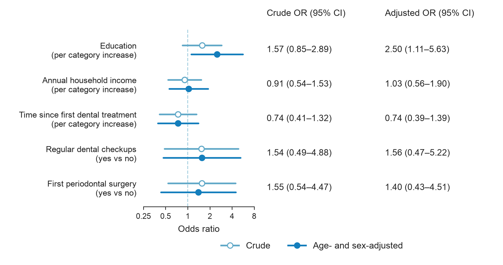

Wei Luo^1,\ #^, Runlang Pan^1,\ #^, Shuting Liu^1^, Manying Zhou^1^, Ting Zhang^1^, Yingsi Huang^1,\ \*^, Wenguang Qin^1,\ \*^

^1^ 广州医科大学口腔医学院及附属口腔医院牙周科，广东省口腔修复与重建工程技术研究中心，中国广州，510182

^#^ 这些作者对本研究贡献相同，并列为第一作者。

^\*^ **通信作者**：  
Wenguang Qin: 2015686011@gzhmu.edu.cn  
Yingsi Huang: 467965641@qq.com  

**英文正文词数**： 4,391 词（不含摘要、参考文献、表格和图注）  
**英文摘要词数**： 283 词  
**图片数量**： 3  
**表格数量**： 3  

**摘要**

目的：描述接受牙龈退缩牙周膜龈手术患者的术前信息寻求行为及对具体手术的理解程度，识别与从专业医疗渠道获取信息相关的因素，为医学生和初级临床医生开展术前健康教育提供依据。方法：在中国一家三级口腔医院开展单中心横断面问卷调查，于术后 6 个月随访时回顾性评估术前焦虑及信息寻求行为。筛查了 2022 年 7 月至 2025 年 12 月接受牙周手术的 2,876 名患者的医院记录。72 名因 Cairo RT1 型牙龈退缩接受膜龈手术的患者中，66 名提交有效问卷并纳入分析。各因素分别通过未调整以及经年龄和性别调整的探索性模型进行评估，并开展 Firth 敏感性分析。结果：总体上，93.94% 的患者报告在治疗前了解过手术，45.45% 选择专业医护人员作为信息来源。对具体手术的理解程度较好（96.97% 理解手术过程；98.48% 知道需要进行牙周基础治疗）。65.15% 的患者报告存在轻度术前焦虑。经年龄和性别调整后，教育程度呈正向趋势（OR = 2.50，95% CI：1.11–5.63，*P*= 0.026）；Firth 敏感性分析估计值为 2.24（95% CI：1.11–5.20，*P*= 0.022）。患者报告心理负担、全身健康状况及手术费用影响其决策。术前焦虑与术后反应及心理负担对决策的影响呈正向关联，术后反应与患者报告的对未来手术决策的影响相关。结论：在已接受膜龈手术的患者中，教育程度与从专业渠道寻求信息存在探索性关联。回忆的术前焦虑、术后反应及患者报告的决策影响因素之间亦存在统计关联。其对术前沟通的意义仍需前瞻性评估。

关键词：牙龈退缩；健康知识、态度与实践；调查与问卷；口腔健康教育；健康寻求行为

**引言**

牙龈退缩（gingival recession，GR）是指龈缘从釉牙骨质界向根尖方向移位，导致根面暴露，是临床口腔医学中最常见的膜龈问题之一。GR 可导致牙本质敏感、根面龋、非龋性颈部缺损、菌斑控制困难及前牙区美观问题，进而影响口腔健康和生活质量（1–3）。近期一项纳入 22 项观察性研究的系统综述和 meta-analysis 报告，以 ≥1 mm 为阈值时，全球 GR 患病率为 81.1%（95% CI：73.9–86.7）；以 ≥3 mm 和 ≥5 mm 为阈值时，患病率分别为 48.4% 和 16.2%（4）。随着生活水平提高和美观需求增加，更多患者因 GR 寻求牙科治疗。因此，处理 GR 相关的美观和功能问题已成为牙周临床的常见需求。

膜龈手术是 GR 的主要治疗方式，根面覆盖术是处理该问题的关键技术（5）。尽管膜龈手术技术日趋成熟，关于接受这些手术的患者如何获取术前信息、如何理解手术相关细节的证据仍然有限。一项纳入 205 名参与者的横断面研究显示，在临床诊断为 GR 的 147 名患者中，38.8% 不知晓自身牙龈退缩，且缺乏疾病认知与性别、教育程度及口腔卫生习惯相关（6）。然而，针对接受牙周膜龈手术患者的术前信息寻求模式和具体手术理解程度的系统调查仍较少。了解手术必要性、过程、风险、费用及预期效果有助于作出知情治疗决策（7，8）。此外，术前焦虑、术后反应、心理负担及患者报告的对未来手术决策的影响之间的关系仍需进一步研究。

因此，本研究对接受牙周膜龈手术的 GR 患者开展术后问卷调查。研究旨在描述牙周膜龈手术的术前信息寻求行为及对具体手术的理解程度，分析与从专业医疗渠道获取信息相关的因素，并考察术前焦虑、术后反应、心理负担及患者报告的对未来手术决策的影响之间的关系。研究结果可为医学生和初级临床医生开展术前沟通及健康教育确定相关主题；本研究未评估其对手术接受度及治疗效果的影响。

**方法**

**研究设计与数据收集**

本研究经广州医科大学附属口腔医院伦理委员会批准（批准号：LCYJ2023055）。获批方案涵盖对自 2022 年 7 月起接受手术的患者开展问卷调查。筛查了 2022 年 7 月至 2025 年 12 月在广州医科大学附属口腔医院接受牙周手术的 2,876 名患者，其中 72 名因 Cairo RT1 型 GR 接受牙周膜龈手术。本研究为在预定的术后 6 个月随访时开展的横断面问卷调查，通过医院电子病历系统及术后随访登记资料识别符合条件的患者。招募覆盖该手术时间范围内识别出的所有符合条件的患者，最终分析样本经问卷质量筛查后确定。未进行事先样本量估算或统计效能计算。术前焦虑和信息寻求行为通过回顾性方式评估。研究报告遵循横断面研究的加强流行病学观察性研究报告质量（Strengthening the Reporting of Observational Studies in Epidemiology，STROBE）指南（9）及互联网电子调查结果报告清单（Checklist for Reporting Results of Internet E-Surveys，CHERRIES）（10）。填写完成的清单见补充材料 S1 和 S2。

纳入标准如下：（1）临床诊断为 Cairo RT1 型 GR；（2）接受牙周膜龈手术；（3）年龄 ≥18 岁；（4）能够独立完成问卷；（5）提供参与问卷调查的电子知情同意。

排除标准如下：（1）严重全身性疾病，包括未控制的高血压、糖尿病或严重心脑血管疾病；（2）精神疾病或认知障碍；（3）妊娠或哺乳期；（4）既往接受过牙周膜龈手术（有非膜龈类牙周手术史的患者可纳入）。

调查由研究团队中的一名资深护士和医学生实施，所有调查员均在正式调查前接受研究目的及参与者资格标准的统一培训。调查员在门诊首次联系符合条件的患者，并仅通过微信私发问卷星链接进行招募；参与完全自愿，不提供奖励，也不公开宣传。患者在各自预定的术后 6 个月随访时，通过链接阅读说明研究目的及预计填写时间的知情同意页，主动提供电子知情同意后方可进入问卷。填写完成的答案由平台自动收集。

访问问卷须注册。整个调查期内，同时限制每个 IP 地址及微信账号仅可提交一次。问卷星自动设置和读取浏览器 Cookie，为客户端分配用户标识，并将同一设备、同一浏览器的重复填写识别为已完成。Cookie 有效期未记录。同意及数据收集后，另在平台后台筛查日志，未发现重复记录。原始未脱敏数据仅允许调查员访问。仅分析已提交问卷，不纳入未完成问卷。所有题目均须作答后方可提交，以避免漏答；“不愿回答”按相应变量的缺失值处理。填写时间 ≤120 s、信息错误或答案高度重复的问卷被判定为无效。一项在线健康问卷调查曾使用类似的 120 s 排除阈值（11）。本研究采用的界值为研究特定的筛查阈值，未针对本问卷进行验证。

全部 72 名受邀患者均访问知情同意页、同意参与并提交问卷。受邀患者应答率、CHERRIES participation rate（同意参与人数/知情同意页访问人数）及 completion rate（提交问卷人数/同意参与人数）均为 100%（72/72）。质量筛查后排除 6 份问卷，66 份纳入分析（有效问卷率为 91.7%；66/72 份已提交问卷）。未保留 6 名被排除应答者的个体记录，因此无法报告其特征及按原因划分的排除数量。在数据收集和分析过程中，两名研究者在统计分析前独立核查问卷数据。样本筛选流程见图 1。

另收集临床特征以描述样本，包括治疗牙、退缩深度、角化组织宽度、手术技术、腭部移植物获取、移植物尺寸、术后用药及术后 6 个月根面覆盖率。对于多个相邻治疗牙，每名患者记录其退缩深度、角化组织宽度及根面覆盖率的最小值。

**问卷**

问卷参考 WHO 口腔健康报告、第四次中国全国口腔健康流行病学调查及相关国内外文献制定（12–15）。初稿完成后，由 6 名口腔医学和护理学专家评审题目的相关性、清晰度和适宜性，并据此修订。随后在便利选取的 10 名患者中开展预调查，以评估各题目是否易于理解并减少歧义。正式调查前测试了电子问卷的可用性及技术功能。该问卷用于收集不同领域的题目层面信息，并非测量单一构念的心理测量量表。因此未计算总分，内部一致性（Cronbach's alpha）不适用，各题目分别分析。

问卷包括三个部分：（1）患者基本信息，包括性别、年龄、教育程度、婚姻状况、收入水平、医疗保险类型及牙科就诊史；（2）术前信息寻求、对具体手术的理解程度及围手术期体验，包括信息来源、对手术过程的理解、术前焦虑、医患沟通、知情同意、对牙周基础治疗的知晓情况及术后反应；（3）患者报告的影响手术决策的因素，包括对手术的理解、费用、心理负担、全身健康状况及后续治疗选择。调查共四页：第 1 页为电子知情同意，第 2 页为基本信息（第 1–9 题），第 3 页为术前信息及围手术期体验（第 10–15 题），第 4 页为决策影响因素（第 16–20 题）。20 道单选题按补充材料 S3 的固定顺序呈现，未使用自适应提问。应答者可在提交前查看并修改答案。术前信息来源题目要求患者从互联网、身边的人、主治医生或护士、未获取信息四个选项中选择一项。问卷中文版见补充材料 S3。

患者从预设选项中选择最符合其回忆中的术前焦虑和术后反应的描述，调查员不进行分级。焦虑类别为无焦虑；轻度焦虑（紧张、不安、原因不明的担忧或恐慌）；中度焦虑（持续紧张和不安、担忧、心悸或心跳剧烈）；重度焦虑（持续紧张和不安，伴有担忧及头痛、头晕、腹痛或腹泻等身体症状）。术后反应类别为无特殊不适；轻微症状（轻微出血、疼痛或肿胀）；明显不适（明显疼痛或肿胀，需要口服镇痛药缓解）。这些内容为问卷选项描述，并非经过验证的诊断或临床严重程度标准。

**统计分析**

采用 SPSS 25.0 进行统计分析。分类数据以频数和百分比 *n*(%) 表示。连续临床变量以中位数和范围概括。因变量为从专业渠道寻求信息，定义为在术前信息来源题目中选择主治医生或护士，相对于选择任何其他选项。 

年龄、教育程度、收入及距首次牙科治疗的时间保留问卷原始类别，不进行合并。这些类别在问卷制定时参考既往文献设定，并非根据观察结果选择。类别边界见表 3 及补充材料 S3。参照使用有序教育得分估计趋势的方法（16），教育程度（大专以下、大专、本科及研究生）、收入及距首次牙科治疗的时间按原始类别升序分别赋分为 0–3、0–4 和 0–3。趋势 OR 对应得分增加 1 分，即升高一个原始类别。得分表示类别顺序，而非等距的受教育年数、收入金额或治疗时间间隔，并假定相邻类别间对数优势的增量相同。年龄、婚姻状况和医疗保险作为分类变量纳入。“不愿回答”按缺失值处理，仅在收入主要分析模型（*n* = 14，21.2%）或婚姻状况模型（*n* = 1）中排除，未进行数值插补。另开展收入敏感性分析，保留全部 66 名患者，将五个原始收入档次及“不愿回答”作为六个名义类别，以 <150,000 CNY 为参照。由于最高收入档次无人选择专业渠道，采用经年龄和性别调整的 Firth logistic regression。

对全部九个人口学、社会经济及牙科就诊史因素分别拟合未调整的 logistic regression。除年龄和性别外，各因素随后在单独模型中进行评估，并调整年龄（18–44、45–59、>60 岁）及性别。年龄和性别在同一模型中相互调整。所有因素均采用这一有限调整，不依据单变量 *P* 值筛选（17）。由于信息寻求模式可能随年龄和性别而异，选择年龄和性别作为基本人口学调整变量（18）。目标因素之间未相互调整，因此估计值描述的是基本调整后的关联。当最大似然估计为有限值时，报告优势比（odds ratio，OR）、95% 置信区间（confidence interval，CI）及 Wald *P* 值；因素整体检验采用似然比检验。对每个调整模型均采用 Firth 惩罚 logistic regression 进行敏感性分析，使用剖面惩罚似然 CI 和惩罚似然比检验（19）。由于稀疏类别导致普通回归出现分离，婚姻状况和医疗保险仅能通过 Firth 获得有限估计值。每个预测参数的事件数（events per predictor parameter，EPV）按结局事件数除以预测参数数计算，不计截距，分类变量的指示参数分别计数。完整结果及模型样本量见补充材料 S4。

为进一步探索围手术期体验与手术决策的关联，评估了三组关系：术前焦虑与术后反应、术前焦虑与心理负担对决策的影响、术后反应与患者报告的对未来手术决策的影响。采用线性趋势关联检验（linear-by-linear association test）评估趋势，以 Goodman–Kruskal gamma（γ）及其 95% CI 描述方向和强度。焦虑、术后症状及对未来手术的影响按从无到较高程度排序；心理负担编码为否或是。γ 的 95% CI 通过 10,000 次患者层面的 bootstrap 重抽样获得。所有回归及有序关联分析均为探索性分析，用于提出假设。*P* 值未进行多重比较校正，仅作描述性解释。由于所有患者的手术技术及是否存在腭部供区均相同，未将两者纳入协变量。未开展亚组或交互作用分析，未采用抽样加权或倾向评分校正，也未使用复杂抽样设计。

**结果**

**术前信息寻求、对具体手术的理解程度及决策影响因素**

66 名患者共有 98 颗治疗牙。所有患者均采用信封式技术，联合使用通过单切口技术获取的腭部结缔组织移植物（connective tissue graft，CTG）。退缩深度中位数为 3 mm（范围：2–5 mm），角化组织宽度中位数为 2 mm（范围：1–3 mm），术后 6 个月根面覆盖率中位数为 83.3%（范围：66.7–100%）。临床特征汇总见表 1。

总体上，93.94% 的患者报告在治疗前了解过手术，45.45% 选择专业医护人员（主治医生或护士）作为信息来源。对具体手术的理解程度总体较好：96.97% 的患者部分或完全理解膜龈手术过程，98.48% 知道术前需要进行牙周基础治疗，80.30% 回忆曾签署知情同意书。65.15% 的患者报告轻度术前焦虑。对于手术决策影响因素，83.33% 的患者报告其对手术的理解影响决策，71.21% 考虑全身健康状况，57.58% 受心理负担影响，46.97% 考虑手术费用。其他结果见表 2。

**与从专业渠道寻求信息的未调整及调整后关联**

女性占样本的 65.15%，18–44 岁患者占 59.09%，本科或研究生学历患者占 75.76%，定期进行口腔检查者占 75.76%，报告首次接受牙周手术者占 68.18%。原始类别分布见表 3。教育程度的未调整趋势估计值为 OR = 1.57（95% CI：0.85–2.89，*P*= 0.151）。普通回归中可获得有限估计值的其他因素，其未调整整体 *P* 值均 >0.05；婚姻状况和医疗保险的稀疏类别导致分离。

经年龄和性别调整后，教育程度的趋势估计值为 OR = 2.50（95% CI：1.11–5.63，*P*= 0.026）。Firth 敏感性分析估计值为 OR = 2.24（95% CI：1.11–5.20，*P*= 0.022）。教育程度模型包含 30 个事件和四个预测参数，EPV = 7.50。其他因素的调整模型整体 *P* 值均 >0.05，包括婚姻状况（Firth *P*= 0.789）和医疗保险（Firth *P*= 0.317）。商业保险与自费的比较得到 Firth OR = 18.94（95% CI：1.11–2925.95，*P*= 0.042；商业保险类别 *n*= 2）。66 名患者中有 14 名收入数据缺失（21.2%）。在将这些患者保留为单独类别的敏感性分析中，收入整体检验得到 *P* = 0.643；与 <150,000 CNY 相比，收入缺失类别的调整后 OR = 0.38（95% CI：0.06–1.86，*P* = 0.239）（补充材料 S4，表 S4）。五个趋势或二分类目标因素的未调整及调整后估计值见图 2；全部估计值、敏感性分析及 EPV 见补充材料 S4。

图 2. 与从专业渠道寻求信息的未调整及调整后关联。空心及实心圆分别表示未调整及调整后的 OR；水平线表示 95% CI，虚线表示 OR = 1。每个调整模型包含一个目标因素、原始年龄类别及性别；目标因素之间未相互调整。教育程度、收入及距首次牙科治疗时间的 OR 表示原始类别升高一级；另外两项比较为是相对于否。收入模型纳入 52 名患者，其他模型纳入 66 名。婚姻状况、医疗保险及 Firth 敏感性分析的完整结果见补充材料 S4。

**围手术期体验与患者报告的决策影响因素之间的关联**

术前焦虑程度与术后反应呈正向关联（γ = 0.611，95% CI：0.213–0.865，*P* = 0.009）。无焦虑组中，60.0% 的患者报告术后无特殊不适。轻度焦虑组中，67.4% 报告轻微症状。中度焦虑组的所有患者均报告轻微症状。术前焦虑与心理负担对决策的影响也呈正向关联（γ = 0.783，95% CI：0.477–0.956，*P* < 0.001）。无焦虑组中仅 25.0% 的患者报告心理负担影响其手术选择，而轻度焦虑组该比例增至 69.8%，中度焦虑组为 100.0%。术后反应与患者报告的对未来手术决策的影响呈正向关联（γ = 0.740，95% CI：0.436–0.945，*P* < 0.001）。无术后不适组中，76.0% 报告本次体验不会影响未来手术决策。轻微症状组中，70.0% 报告轻微影响。存在明显不适的患者（*n* = 1）报告轻微影响。详见图 3。

**讨论**

本问卷调查纳入 66 名接受膜龈手术的 GR 患者，系统描述了其术前信息寻求模式、对具体手术的理解程度及围手术期体验。经年龄和性别调整后，教育程度与从专业渠道寻求信息呈正向趋势，并观察到术前焦虑、术后反应、心理负担及患者报告的对未来手术决策的影响之间的关联。本研究聚焦于实际接受膜龈手术的患者，同时评估术前信息获取和围手术期体验，补充了既往关于患者 GR 认知的证据（6）。

66 名应答者中，93.94% 报告在治疗前了解过手术，45.45% 选择主治医生或护士作为信息来源。术前焦虑发生比例为 69.70%，以轻度焦虑为主。对具体手术的理解程度总体较好：96.97% 的患者部分或完全理解膜龈手术过程，98.48% 知道术前牙周基础治疗的必要性。这些描述性指标反映患者对手术过程的理解和知识，可能与三级专科门诊常规术前说明及针对性的口腔健康教育有关（20，21）。然而，仍有 12.12% 的患者未清楚理解医患沟通内容（表 2），提示现有术前健康教育可能缺少个体化设计。Jönsson 等发现，个体化口腔健康教育的临床价值高于标准化教育（22），支持优化术前沟通的必要性。

明确患者的信息寻求特征后，进一步分析了与从专业渠道寻求信息相关的关键因素。教育程度的未调整趋势未达到 *P*<0.05（OR = 1.57，95% CI：0.85–2.89，*P*= 0.151），经年龄和性别调整后的趋势为正向（OR = 2.50，95% CI：1.11–5.63，*P*= 0.026；图 2）。Firth 敏感性分析得到相似方向（OR = 2.24，95% CI：1.11–5.20，*P*= 0.022）。既往研究表明，教育程度与患者获取和理解健康信息的能力密切相关，并可能影响牙科服务利用和信息寻求模式（23–25）。尤其是近期证据提示，健康素养较高者可能更倾向于依赖包括口腔专业人员在内的可靠牙科信息来源，但不同研究中并非一致观察到这一关联（25）。这些发现可能为本研究观察到的关联提供一种解释。其他因素在基本调整分析中的整体 *P* 值均 >0.05。商业保险比较仅基于两名患者，CI 非常宽。模型未对目标因素相互调整，教育程度估计值表示赋予类别得分的趋势，而非独立效应或因果效应。本小样本研究不能排除其他特征与该结局的关联。

除社会经济因素外，手术决策中的心理、全身健康及经济因素也不应忽视。本调查中，57.58% 的患者报告心理负担影响其手术选择（图 3B），71.21% 关注全身健康状况对手术的影响。手术费用影响 46.97% 患者的手术决策（表 2），与既往认为经济因素是择期牙周整形手术重要现实障碍的证据一致（7，8）。Wright 等报告，包括焦虑和人格特征在内的患者行为因素可显著影响种植治疗效果（26），与本研究中心理负担影响手术选择的发现一致。牙科焦虑和牙科恐惧症常始于儿童期，可持续至成年，导致治疗相关的心理负担、回避牙科治疗，继而使口腔健康及生活质量下降（27–29）。认知行为治疗已被证实可有效减轻牙科治疗前的焦虑和心理负担（30，31）。此外，尽管膜龈手术是局部手术，全身性疾病控制在牙周整形手术中仍具有临床意义（32）。特别是糖尿病和血糖控制不佳可损害口腔软组织伤口愈合并影响手术效果（33）。因此，患者对全身健康状况的担忧反映了对伤口愈合及手术预后的合理考量。这些报告的担忧可作为术前讨论主题；本调查未评估心理评估、咨询或全身状况评估的效果。

Patient-reported outcome measures（PROMs）为本研究的术后反应提供了临床背景。Cairo 等关于单牙牙龈退缩 root coverage 的 systematic review 评估了患者感知的美观、满意度及术后疼痛或不适；由于 morbidity 测量存在异质性，未能进行定量合并（34）。Tonetti 等关于多牙牙龈退缩 root coverage 的多中心随机试验发现，与 CTG 相比，异种 collagen matrix 缩短了恢复时间及镇痛药使用时间，但 CTG 获得了更好的根面覆盖效果（35）。这些证据支持在术前沟通中同时讨论预期不适、恢复过程及根面覆盖获益。本调查所有患者均接受腭部 CTG；回顾性的术后反应题项描述的是回忆的症状，并非经过验证的 PROM，也不能区分供区与受区的 morbidity 或比较不同移植材料。

探索性关联分析显示，术前焦虑、术后反应、心理负担及患者报告的对未来手术决策的影响之间存在关系。术前焦虑较高的患者倾向于报告更明显的术后不适（图 3A，*P* = 0.009）。口腔外科其他领域也有类似趋势，例如一项对 213 名接受第三磨牙拔除术患者开展的前瞻性队列研究测量了术前牙科焦虑，并观察到其与术后症状严重程度相关（36）。焦虑程度也与患者报告的心理负担对手术选择的影响相关（图 3B，*P* < 0.001）。无焦虑患者中仅少数报告心理负担影响手术选择，而所有中度焦虑患者均报告这一影响。牙科焦虑的经典研究将这一过程描述为恶性循环：焦虑引发治疗回避，负面牙科经历强化焦虑预期，对后续干预的心理抵触增加，使患者在面临另一次手术决策时承受更重的心理负担（30，37）。术后反应与患者报告的对未来手术决策的影响相关（图 3C，*P* < 0.001）。多数无明显术后不适的患者报告本次体验不会影响未来手术决策，而有症状的患者更常报告会影响未来手术决策。其他手术场景的证据为术前预期引导研究提供了背景。一项纳入 172 名接受全膝关节置换术患者的随机对照试验显示，接受关于现实预期的结构化术前教育者，其术后满意度及再次接受手术的意愿均显著高于对照组，提示现实预期引导可减少预期未满足所致的负面体验（38）。尽管本调查的术后反应总体较轻，术后症状管理及术前预期引导是否影响后续决策仍需前瞻性检验。本研究未测量手术回避。这三项探索性分析未调整其他协变量或多重比较，其关联需在更大规模的纵向研究中确认。

本研究具有若干优势。首先，通过连续筛查 3.5 年内全部牙周手术患者队列识别参与者，且全部 72 名受邀患者均提交问卷。此外，研究聚焦于因牙龈退缩实际接受膜龈手术、相对同质且具有特定手术特征的患者群体，使信息寻求行为、术前焦虑、术后体验及患者报告的对未来手术决策的影响得以在同一已治疗群体中描述。其次，问卷在正式实施前经专家评审和预调查，并通过电子提交控制及质量筛查限制重复提交、漏答及潜在不可靠回答。最后，统计分析前两名研究者独立核查问卷数据，进一步加强了数据质量。

本研究存在若干局限。主要局限为回忆偏倚：术前焦虑及信息寻求行为是在术后 6 个月随访时回忆，而非术前测量。术后体验可能影响这些回忆及观察到的关联；该回忆偏倚的方向和程度无法确定。排除六份问卷也可能引入选择偏倚，由于未保留其个体记录，无法评估该偏倚。统一的随访时间点限制了回忆时段的差异，但未消除这一偏倚。所有参与者均已接受手术，未纳入拒绝手术者。因此，决策题目描述的是应答者感知的影响，而非区分手术接受与拒绝的因素。未来治疗题目测量的是表达的意向，而非观察到的接受或回避行为。教育程度模型包含 30 个事件及四个预测参数（EPV = 7.50）；各调整模型 EPV 为 4.29–10.00。婚姻状况和医疗保险的稀疏类别导致分离。Firth 估计解决了这一估计问题，但小类别仍产生较宽的 CI。模型仅进行有限的人口学调整，仍可能存在残余混杂。协变量调整及类别赋分未记录于预先制定的分析计划，因此这些发现应视为探索性。有序得分趋势项假定相邻类别间对数优势的增量相同。由于未进行多重比较校正，可能出现偶然发现。研究未事先计算样本量，因此其设计不能确保对所考察关联具有足够的统计效能。这些探索性发现需在更大样本中验证。

此外，单选信息来源题目无法反映同一患者使用多个渠道的情况。因此，来源比例及回归结局反映的是所选答案，同时咨询过临床医生的患者可能被归入其他类别。尽管问卷经专家评审并在 10 名患者中开展预调查，其效度和重测信度未进行正式评估。术前焦虑通过自行设计的四级题目而非经过验证的量表评估，其测量精度仍不确定。两项知识题目未作为量表进行验证，且存在天花板效应，因此仅作描述性报告，未计算综合得分。 

单中心样本仅包含已接受治疗、能够独立填写电子问卷的 Cairo RT1 患者。因此，结果对其他中心、其他退缩类型、拒绝手术者及无法填写电子问卷者的可推广性有限。

最后，横断面问卷调查设计无法确定信息寻求行为与围手术期体验之间的因果关系。未来更大样本的多中心前瞻性研究应采用经过验证的心理测量量表，更准确地量化心理状态，并探索结构化术前教育干预对手术接受度及患者报告结局的影响。

**结论**

在已接受膜龈手术的 GR 患者中，93.94% 报告在治疗前了解过膜龈手术，45.45% 选择专业医护人员作为信息来源。经年龄和性别调整后，较高教育程度与从专业渠道寻求信息呈正向趋势，提示教育程度可能有助于指导未来个体化口腔健康教育研究。此外，术前焦虑与术后反应及心理负担存在探索性关联，术后反应与患者报告的对未来手术决策的影响相关。这些发现描述的是已治疗群体内的关联，未识别接受或拒绝手术的决定因素。其对个体化术前沟通和教育的意义仍需前瞻性评估。

**作者贡献**

Wei Luo：研究构思、方法设计、调查、数据整理、初稿撰写。Runlang Pan：正式分析、可视化、初稿撰写。Shuting Liu：调查、数据整理。Manying Zhou：调查、数据整理。Ting Zhang：调查、数据整理。Yingsi Huang：经费获取、审阅与编辑。Wenguang Qin：研究构思、方法设计、监督、正式分析、审阅与编辑。

**基金资助**

本研究获广东省基础与应用基础研究基金（2023A1515030037）、广州医科大学口腔医学院教育科学规划与教学改革项目“三维融合·五育协同：构建与实践思政和数智双向赋能的牙周病学实践教学模式”及广州市教育局高校科研项目（2024312042）资助。资助方未参与研究设计、数据收集、分析、稿件撰写或投稿决定。

**致谢**

作者感谢所有参与本研究的患者、协助发放问卷的广州医科大学附属口腔医院荔湾院区牙周科护理人员，以及参与问卷内容效度验证的医学专家。

**利益冲突声明**

作者声明，本研究不存在任何可能被视为潜在利益冲突的商业或财务关系。

**伦理声明**

本研究经广州医科大学附属口腔医院伦理委员会审查并批准（批准号：LCYJ2023055）。获批方案涵盖对自 2022 年 7 月起接受手术的患者进行回顾性筛查。参与者在填写微信问卷前提供电子知情同意。

**数据可用性声明**

支持本文结论的原始数据将由作者在合理请求下提供，不作不当限制。

**参考文献**

1. Reis MBL, Mandetta CMR, Dantas CDF, Marañón-Vásquez G, Taba M Jr, de Souza SLS, et al. 伴非龋性颈部缺损的牙龈退缩根面覆盖：对照临床试验. *Clin Oral Investig* (2020) 24:4583–9. doi: 10.1007/s00784-020-03325-1.

2. Santamaria MP, Miguel MMV, Rossato A, Bonafé ACF, de Souza IV, Martins TM, et al. 采用体积稳定的胶原基质治疗伴非龋性颈部缺损的牙龈退缩：随机临床试验. *J Periodontol* (2026) 97:62–73. doi: 10.1002/jper.11386.

3. Cortellini P, Bissada NF. 天然牙列中的膜龈状况：叙述性综述、病例定义及诊断考量. *J Periodontol* (2018) 89(Suppl 1):S204–13. doi: 10.1002/JPER.16-0671.

4. Marschner F, Lechte C, Kanzow P, Hraský V, Pfister W. 牙龈退缩患病率及危险因素的系统综述和 meta-analysis. *J Dent* (2025) 155:105645. doi: 10.1016/j.jdent.2025.105645.

5. Zucchelli G, Mounssif I. 牙周整形手术. *Periodontol 2000* (2015) 68:333–68. doi: 10.1111/prd.12059.

6. Yılmaz M, Oduncuoğlu BF, Nişancı Yılmaz MN. 评估患者对牙龈退缩的感知、其对口腔健康相关生活质量的影响及治疗计划接受度. *Acta Odontol Scand* (2020) 78:454–62. doi: 10.1080/00016357.2020.1758773.

7. Miller TA. 慢性及急性疾病中的健康素养与医疗治疗依从性：meta-analysis. *Patient Educ Couns* (2016) 99:1079–86. doi: 10.1016/j.pec.2016.01.020.

8. McCaffery KJ, Holmes-Rovner M, Smith SK, Rovner D, Nutbeam D, Clayman ML, et al. 在患者决策辅助工具中应对健康素养问题. *BMC Med Inform Decis Mak* (2013) 13(Suppl 2):S10. doi: 10.1186/1472-6947-13-S2-S10.

9. von Elm E, Altman DG, Egger M, Pocock SJ, Gøtzsche PC, Vandenbroucke JP, et al. 加强流行病学观察性研究报告质量（STROBE）声明：观察性研究报告指南. *Bull World Health Organ* (2007) 85:867–72. doi: 10.2471/BLT.07.045120.

10. Eysenbach G. 提高网络调查质量：互联网电子调查结果报告清单（CHERRIES）. *J Med Internet Res* (2004) 6:e34. doi: 10.2196/jmir.6.3.e34.

11. Yang S, Chen Y, Zhou L, Huang Y, Dai J. COVID-19 疫情期间中国家长采用 mHealth 的意愿：横断面问卷研究. *JMIR Mhealth Uhealth* (2021) 9:e23155. doi: 10.2196/23155.

12. An R, Chen W, Li S, Wu Z, Liu M, Sohaib M. 中国护士口腔健康素养及口腔健康行为评估：横断面研究. *BMC Oral Health* (2022) 22:602. doi: 10.1186/s12903-022-02658-5.

13. Deeden S, Vichayanrat T, Asvanund Y, Prapansilp W, Phonghanyudh A. 泰国医务人员对儿童早期龋（ECC）预防的知识、态度与实践. *Int Dent J* (2024) 74:253–9. doi: 10.1016/j.identj.2023.08.008.

14. Tsui PK, Chau PH, Wong JYH, Wang MP, Gao X, Lam OLT, et al. 香港急性期医院护理人员的口腔护理知识、态度与实践. *PLoS One* (2023) 18:e0289953. doi: 10.1371/journal.pone.0289953.

15. Tan L, Lin Z, Zhang Y, Sun N, Ding Q, Feng H, et al. 重性抑郁障碍青少年及年轻成人非自杀性自伤行为中的信息–知识–态度–实践模式：随机对照试验. *J Psychiatr Ment Health Nurs* (2025) 32:766–73. doi: 10.1111/jpm.13154.

16. Yan LL, Liu K, Daviglus ML, Colangelo LA, Kiefe CI, Sidney S, et al. 青年期及成年早期至中期的教育程度、15 年危险因素进展及冠状动脉钙化：青年人冠状动脉危险因素发展研究. *JAMA* (2006) 295:1793–800. doi: 10.1001/jama.295.15.1793.

17. Heinze G, Wallisch C, Dunkler D. 变量选择：综述及对实际从事统计工作的人员的建议. *Biom J* (2018) 60:431–49. doi: 10.1002/bimj.201700067.

18. Vazquez CE, Mauldin RL, Mitchell DN, Ohri F. 美国使用 eHealth 寻求信息相关的社会人口学因素：基于健康信息全国趋势调查三个时间点数据的人群横断面研究. *J Med Internet Res* (2024) 26:e54745. doi: 10.2196/54745.

19. Heinze G, Schemper M. logistic regression 中分离问题的一种解决方法. *Stat Med* (2002) 21:2409–19. doi: 10.1002/sim.1047.

20. Wittink H, Oosterhaven J. 患者教育与健康素养. *Musculoskelet Sci Pract* (2018) 38:120–7. doi: 10.1016/j.msksp.2018.06.004.

21. Margat A, Gagnayre R, Lombrail P, de Andrade V, Azogui-Levy S. 健康素养与治疗性教育干预：文献综述 [健康素养与患者教育干预：综述]. *Sante Publique* (2017) 29:811–20. doi: 10.3917/spub.176.0811.

22. Jönsson B, Ohrn K, Lindberg P, Oscarson N. 个体化口腔健康教育计划对牙周健康的效果评估. *J Clin Periodontol* (2010) 37:912–9. doi: 10.1111/j.1600-051X.2010.01590.x.

23. Stormacq C, Van den Broucke S, Wosinski J. 健康素养是否介导社会经济地位与健康差异之间的关系？整合性综述. *Health Promot Int* (2019) 34:e1–17. doi: 10.1093/heapro/day062.

24. Ju X, Jamieson LM, Mejia GC, Mittinty MN. 口腔健康素养对自报牙齿缺失的影响：多重中介分析. *Community Dent Oral Epidemiol* (2022) 50:445–52. doi: 10.1111/cdoe.12699.

25. Lu X, Nanjappa S, Wijesiri TID, Mossey P, Yuan S. 健康素养在成人牙科服务利用中的作用：范围综述. *Community Dent Oral Epidemiol* (2026) 54:133–45. doi: 10.1111/cdoe.70037.

26. Wright KE, Luz DS, Dragan IF. 应用患者行为评估改善种植治疗效果. *Compend Contin Educ Dent* (2025) 46:336–42.

27. Seligman LD, Hovey JD, Chacon K, Ollendick TH. 牙科焦虑：青少年中研究不足的问题. *Clin Psychol Rev* (2017) 55:25–40. doi: 10.1016/j.cpr.2017.04.004.

28. Kassem El Hajj H, Fares Y, Abou-Abbas L. 黎巴嫩成年人牙科焦虑及牙科恐惧症的评估. *BMC Oral Health* (2021) 21:48. doi: 10.1186/s12903-021-01409-2.

29. Tellez M, Potter CM, Kinner DG, Jensen D, Waldron E, Heimberg RG, et al. 管理牙科焦虑的计算机工具：随机临床试验. *J Dent Res* (2015) 94(9 Suppl):174S–80S. doi: 10.1177/0022034515598134.

30. Armfield JM, Heaton LJ. 牙科诊所中的恐惧与焦虑管理：综述. *Aust Dent J* (2013) 58:390–407. doi: 10.1111/adj.12118.

31. Gordon D, Heimberg RG, Tellez M, Ismail AI. 成人牙科焦虑治疗方法的批判性综述. *J Anxiety Disord* (2013) 27:365–78. doi: 10.1016/j.janxdis.2013.04.002.

32. Sanz M, Simion M. 牙周整形手术及软组织再生的手术技术：第十届欧洲牙周病学研讨会第三组共识报告. *J Clin Periodontol* (2014) 41(Suppl 15):S92–7. doi: 10.1111/jcpe.12215.

33. Ko KI, Sculean A, Graves DT. 糖尿病患者口腔软硬组织的伤口愈合. *Transl Res* (2021) 236:72–86. doi: 10.1016/j.trsl.2021.05.001.

34. Cairo F, Couso-Queiruga E, Barbato L, Rupe C, Stuhr S, Chambrone L, et al. Clinician- and patient-reported outcomes following the surgical treatment of single gingival recession defects: A systematic review. *Periodontol 2000* (2025) 99:7–20. doi: 10.1111/prd.12641.

35. Tonetti MS, Cortellini P, Pellegrini G, Nieri M, Bonaccini D, Allegri M, et al. Xenogenic collagen matrix or autologous connective tissue graft as adjunct to coronally advanced flaps for coverage of multiple adjacent gingival recession: Randomized trial assessing non-inferiority in root coverage and superiority in oral health-related quality of life. *J Clin Periodontol* (2018) 45:78–88. doi: 10.1111/jcpe.12834.

36. Qiao F, Zhang M, Zhang T, Zhu D. 牙科焦虑与第三磨牙手术后的症状相关. *Front Psychiatry* (2022) 13:956566. doi: 10.3389/fpsyt.2022.956566.

37. Berggren U, Meynert G. 牙科恐惧与回避：原因、症状及后果. *J Am Dent Assoc* (1984) 109:247–51. doi: 10.14219/jada.archive.1984.0328.

38. Nam HS, Yoo HJ, Ho JPY, Kim YB, Lee YS. 关于现实预期的术前教育可提高全膝关节置换术后存在中枢敏化患者的满意度：随机对照试验. *Knee Surg Sports Traumatol Arthrosc* (2023) 31:4705–15. doi: 10.1007/s00167-023-07487-9.

**图注**

图 1. 样本筛选流程。在 2,876 名接受牙周手术的患者中，依据纳入及排除标准识别 72 名符合条件的患者，并邀请其填写问卷。全部 72 名受邀患者均提交问卷（应答率为 100%）。质量筛查后排除 6 份问卷，最终 66 份纳入分析（有效问卷率为已提交问卷的 91.7%）。

图 3. 围手术期体验与未来手术决策之间的有序关联。A：术前焦虑与术后反应。B：术前焦虑与心理负担对手术选择的影响。C：术后反应与对未来手术决策的影响。堆叠柱表示百分比；柱内及柱上方数字分别表示人数及各组总人数。未调整的 *P* 值来自线性趋势关联检验；γ 为 Goodman–Kruskal gamma 系数，表示各关联的方向和强度。

**表格**

表 1. 接受膜龈手术患者的临床特征

| 特征 | 数值 |
| --- | --- |
| 治疗牙总数 | 98 |
| 每名患者治疗牙数，中位数（范围） | 1 (1–4) |
| 单个治疗牙,*n*(%) | 46 (69.70) |
| 多个治疗牙,*n*(%) | 20 (30.30) |
| 上颌手术,*n*(%) | 36 (54.55) |
| 下颌手术,*n*(%) | 30 (45.45) |
| 退缩深度，mm，中位数（范围） | 3 (2–5) |
| 角化组织宽度，mm，中位数（范围） | 2 (1–3) |
| 信封式技术联合腭部 CTG,*n*(%) | 66 (100.00) |
| 采用单切口技术获取腭部移植物,*n*(%) | 66 (100.00) |
| 移植物长度，mm，中位数（范围） | 12 (8–27) |
| 移植物宽度，mm，中位数（范围） | 6 (4–8) |
| 移植物厚度，mm，中位数（范围） | 1.2 (1.0–1.5) |
| 术后用药方案 A,*n*(%) | 63 (95.45) |
| 术后用药方案 B,*n*(%) | 3 (4.55) |
| 术后 6 个月根面覆盖率，%，中位数（范围） | 83.3 (66.7–100) |

注：*n*= 66；百分比以患者数为分母。每名患者均仅在一个牙弓接受手术。对于多个相邻治疗牙，退缩深度、角化组织宽度及根面覆盖率为治疗牙中的最小值。移植物尺寸描述获取的组织，而非腭部伤口面积。方案 A：阿莫西林 0.5 g 口服，每日三次，共 5 天；方案 B：克林霉素 0.3 g 口服，每日三次，共 5 天。两种方案均包括按需口服布洛芬 0.3 g，以及 0.12% 氯己定漱口液每次含漱 1 分钟、每日两次、共 2 周。CTG，结缔组织移植物。

表 2. 术前信息寻求、对具体手术的理解程度、围手术期体验及决策影响因素

| 条目 | 类别 | *n* (%) |
| --- | --- | --- |
| 术前手术相关信息来源 | 主治医生或护士 | 30 (45.45) |
|  | 网络平台 | 21 (31.82) |
|  | 身边的人 | 11 (16.67) |
|  | 未了解过手术 | 4 (6.06) |
| 对膜龈手术过程的理解 | 完全理解 | 25 (37.88) |
|  | 部分理解 | 39 (59.09) |
|  | 不理解 | 2 (3.03) |
| 知晓术前牙周基础治疗的必要性 | 是 | 65 (98.48) |
|  | 否 | 1 (1.52) |
| 术前焦虑程度 | 无焦虑 | 20 (30.30) |
|  | 轻度焦虑 | 43 (65.15) |
|  | 中度焦虑 | 3 (4.55) |
|  | 重度焦虑 | 0 (0.00) |
| 术前沟通 | 已告知并完全理解 | 58 (87.88) |
|  | 已告知但未完全理解 | 8 (12.12) |
|  | 完全未告知 | 0 (0.00) |
| 签署术前知情同意书 | 已签署 | 53 (80.30) |
|  | 不记得 | 12 (18.18) |
|  | 未签署 | 1 (1.52) |
| 术后反应 | 无特殊不适 | 25 (37.88) |
|  | 轻微症状 | 40 (60.61) |
|  | 明显不适 | 1 (1.52) |
| 手术决策影响因素 |  |  |
| 自报对手术的理解对决策的影响 | 是 | 55 (83.33) |
|  | 否 | 11 (16.67) |
| 手术费用 | 是 | 31 (46.97) |
|  | 否 | 35 (53.03) |
| 心理负担 | 是 | 38 (57.58) |
|  | 否 | 28 (42.42) |
| 全身健康状况 | 是 | 47 (71.21) |
|  | 否 | 19 (28.79) |
| 对未来治疗选择的影响 | 无影响 | 29 (43.94) |
|  | 轻微影响 | 34 (51.52) |
|  | 中度影响 | 3 (4.55) |

注：*N* = 66。数据以 *n* (%) 表示。患者依据补充材料 S3 第 11 和 15 题的预设描述选择焦虑及术后反应；调查员不进行分级。决策回答描述的是已接受手术患者感知的影响。未来治疗回答描述的是表达的意向，而非观察到的决策。

表 3. 与从专业渠道寻求信息相关因素的原始类别分布

| 变量 | 原始类别 | 总计,*n*(%) | 专业渠道,*n*(%) | 其他渠道,*n*(%) |
| --- | --- | --- | --- | --- |
| 性别 | 女 | 43 (65.15) | 22 (51.16) | 21 (48.84) |
|  | 男 | 23 (34.85) | 8 (34.78) | 15 (65.22) |
| 年龄 | 18–44 岁 | 39 (59.09) | 17 (43.59) | 22 (56.41) |
|  | 45–59 岁 | 19 (28.79) | 7 (36.84) | 12 (63.16) |
|  | >60 岁 | 8 (12.12) | 6 (75.00) | 2 (25.00) |
| 教育程度 | 大专以下 | 7 (10.61) | 2 (28.57) | 5 (71.43) |
|  | 大专 | 9 (13.64) | 4 (44.44) | 5 (55.56) |
|  | 本科 | 38 (57.58) | 16 (42.11) | 22 (57.89) |
|  | 研究生 | 12 (18.18) | 8 (66.67) | 4 (33.33) |
| 婚姻状况 | 未婚 | 14 (21.21) | 7 (50.00) | 7 (50.00) |
|  | 已婚 | 49 (74.24) | 20 (40.82) | 29 (59.18) |
|  | 丧偶 | 1 (1.52) | 1 (100.00) | 0 (0.00) |
|  | 离婚 | 1 (1.52) | 1 (100.00) | 0 (0.00) |
|  | 不愿回答 | 1 (1.52) | 1 (100.00) | 0 (0.00) |
| 家庭年收入 | <150,000 CNY | 17 (25.76) | 8 (47.06) | 9 (52.94) |
|  | 150,000–300,000 CNY | 19 (28.79) | 10 (52.63) | 9 (47.37) |
|  | 300,000–500,000 CNY | 9 (13.64) | 4 (44.44) | 5 (55.56) |
|  | 500,000–1,000,000 CNY | 6 (9.09) | 3 (50.00) | 3 (50.00) |
|  | >1,000,000 CNY | 1 (1.52) | 0 (0.00) | 1 (100.00) |
|  | 不愿回答 | 14 (21.21) | 5 (35.71) | 9 (64.29) |
| 医疗保险 | 自费 | 17 (25.76) | 5 (29.41) | 12 (70.59) |
|  | 职工医疗保险 | 33 (50.00) | 16 (48.48) | 17 (51.52) |
|  | 公费医疗 | 13 (19.70) | 7 (53.85) | 6 (46.15) |
|  | 单位报销 | 1 (1.52) | 0 (0.00) | 1 (100.00) |
|  | 商业保险 | 2 (3.03) | 2 (100.00) | 0 (0.00) |
| 距首次牙科治疗的时间 | <1 年 | 9 (13.64) | 4 (44.44) | 5 (55.56) |
|  | 1–5 年 | 38 (57.58) | 20 (52.63) | 18 (47.37) |
|  | 5–10 年 | 10 (15.15) | 3 (30.00) | 7 (70.00) |
|  | >10 年 | 9 (13.64) | 3 (33.33) | 6 (66.67) |
| 定期口腔检查 | 是 | 50 (75.76) | 24 (48.00) | 26 (52.00) |
|  | 否 | 16 (24.24) | 6 (37.50) | 10 (62.50) |
| 首次牙周手术 | 是 | 45 (68.18) | 22 (48.89) | 23 (51.11) |
|  | 否 | 21 (31.82) | 8 (38.10) | 13 (61.90) |

注：*N* = 66。总计列的百分比以全部 66 名患者为分母；两个信息来源列的百分比以各原始类别患者数为分母。专业渠道表示在单选题中选择主治医生或护士；其他渠道包括其余所有回答。<18 岁年龄类别无观察值，故省略。收入及牙科治疗史的原始区间按问卷保留，不推断边界值的确切归属。“不愿回答”单独列出，作为相应变量的缺失数据，仅在该变量的主要回归分析中排除。14 名患者收入缺失（21.2%）；将其保留为单独类别的敏感性分析见补充材料 S4 表 S4。未调整、调整后及 Firth 结果见补充材料 S4。CNY，人民币。
